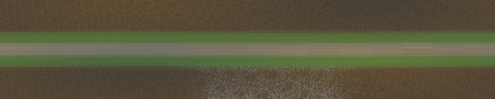

<p align="center">
  
</p>

<h1 align="center">STJ — Standard Track JSON</h1>

<p align="center">
  <b>The track half of the Rosetta Stone for driving simulation.</b><br>
  One open, engine-neutral description of a race track or rally stage, in one OpenUSD file.
</p>

<p align="center">
  <a href="LICENSE"></a>
  
  
  
  <a href="https://github.com/RFloEng/SVJ-standard-vehicle-json"></a>
</p>

---

Every simulator stores tracks its own way: models, surface tables, AI splines, driveline files, terrain blocks, per-time-of-day material sets. None of them can read another's tracks, and when a game is abandoned its tracks go with it.

**STJ** describes a track completely enough for any engine to rebuild it:

- **where the road is**: a reference line with distance `s` and lateral offset `t`, USD meshes, a terrain heightfield
- **what it is made of and how it grips**: surfaces relative to a defined reference road, wet behaviour, loose ground, surfaces that vary inside a mesh
- **how a race on it is run**: timing, grid, pits, racing lines, AI hints, race control, rally controls, pace notes
- **what surrounds it**: vegetation and objects, water, sky, lights, sound, animated objects

It is the sister format of **[SVJ — Standard Vehicle JSON](https://github.com/RFloEng/SVJ-standard-vehicle-json)**. SVJ says what a car is; STJ says what it drives on. Put an SVJ car on an STJ stage and the grip at each tyre follows from both ([spec §6.4](spec/STJ_Spec.md#64-svj-tyre--stj-surface--grip)).

## One track, one OpenUSD stage

A track is an **[OpenUSD](https://openusd.org) stage**: a `.usda` while you work on it, and a single `.usdz` to ship it ([spec §7.8](spec/STJ_Spec.md#78-stj-inside-usd-and-single-file-tracks)).
- **Geometry lives in USD**: meshes, materials, per-face and per-corner data (primvars), animation, instancing, variant sets, streaming payloads ([spec §7.7](spec/STJ_Spec.md#77-openusd-geometry)).
- **The STJ document lives in the same file**, in the root layer's `customLayerData["stj"]`. It holds what USD has no schema for: the reference line, surfaces and grip, timing, race data, pace notes, weather, signals. It points to the geometry by material name or prim path.
- **Variants** (night, wet, winter) are USD layers that sublayer the track, carry an RFC 7396 patch for the document, and select USD variant sets. Any USD tool shows them; STJ tools apply them.
- **A `.usdz` holds only USD layers, images and audio.** A track that uses OpenDRIVE, OpenCRG or raw terrain ships as a folder instead.

The document is JSON checked by a JSON Schema, and `tools/stj_usd.py extract` always writes it back out as plain text for reading and diffing. STJ builds on existing standards instead of reinventing them:
- **OpenUSD** for the container and all geometry
- **ASAM OpenDRIVE** for road layout
- **ASAM OpenCRG** for road surface grids
- **RFC 7396** for variant patches

## What STJ is for, and what it is not

STJ is the **shared starting point** for moving a track between simulators, not a one-click converter.

```
 game A ──import──┐                          ┌──export──▶ game B
 game C ──import──┼──▶  STJ  ◀──▶ Blender ──┼──export──▶ game D
 scans, GIS ──────┘   (the track, described) └──export──▶ game E
```

- **The framework does the mechanical work.** Read a track into STJ once, and each target game starts from a description that is already complete: geometry, surfaces and grip, timing, scenery, weather. That is most of the work, and it is the same work for every target.
- **The last part is hand-tuned, in Blender.** Each game wants its own fine tuning at export, and no shared format changes that. The Blender mapping ([`docs/blender_mapping.md`](docs/blender_mapping.md)) keeps the STJ document and its rules inside the `.blend`, so you finish a track in one place.
- **Engine-specific tuning stays in `x_<engine>`.** What a game needs and no other game does lives next to the shared data, so going back to the same engine loses nothing.
- **It is a hub on purpose.** With N games, direct conversion between every pair needs about N×N converters, and a hub needs two per game. A hub also keeps the meaning: a surface is described once, relative to a reference road, and each target reads that one description, instead of one game's friction numbers being translated into another's.
- **A direct converter for one pair can still do better for that pair.** Existing tools can serve as the export side of the hub: they read STJ (or the Blender scene) and write that game's format.

What STJ does not promise:
- **The same result everywhere.** Loose-surface feel, ground blending and AI racing lines mean different things in different engines. [Spec §14](spec/STJ_Spec.md#14-where-portability-is-a-lie) lists what carries over and what does not.
- **No manual work.** The aim is that manual work is the game-specific finishing, not rebuilding the track.

Planned: a per-target report from each exporter, saying what was converted, what was approximated and what needs a person. STJ already marks estimates (`_est`), what a conversion dropped (`provenance.lost`) and the validator's notes, which a report would build on.

## A first look

This is the document inside a minimal track. A centerline and one surface make a valid, drivable track:

```json
{
  "_metadata": { "specification": "STJ", "version": "0.3", "coordinate_system": "OpenDRIVE", "units": "SI" },
  "track_info": { "name": "My Stage", "type": "point_to_point", "primary_surface": "gravel" },
  "reference": { "centerline": { "points": [[0, 0, 0], [120, 15, 1.2], [260, -10, 2.5]], "width": { "left": 3.5, "right": 3.5 } } },
  "surfaces": {
    "default": "gravel",
    "library": { "gravel": { "class": "gravel", "mf_scaling": { "LMUX": 0.62, "LMUY": 0.58 }, "_est": true } }
  },
  "timing": { "start": { "s": 10 }, "finish": { "s": 250 } }
}
```

Put it into a track, check it, and pack it into one file:

```bash
python tools/stj_usd.py embed my_stage.stj.json my_stage.usda
```

```bash
python tools/validate.py my_stage.usda --strict
```

```bash
python tools/stj_usd.py package my_stage.usda -o my_stage.usdz
```

Everything except `_metadata` is optional. Add what you have: meshes, timing, pace notes, scenery, weather.

## What's inside

| Section | Content |
|---|---|
| `_metadata` | Version, licence (SPDX, redistributable), provenance: original, scanned or converted, with what each conversion step lost; the authoring source file |
| `track_info` | Name, layout, type, country, primary surface, length, short name, tags, media, minimap, records |
| `reference` | OpenDRIVE route, or a centerline (polyline or Hermite spline) with widths, an optional road profile and banking (`cross_section`), a road-terrain rule, and optional stored chainage. Other roads and junctions in `roads[]`. Defines `s` and `t`. |
| `geometry` | USD meshes by role (visual, collision, LOD), OpenCRG grids, terrain heightfields with layers and macro maps; long stages and open areas cut into chunks or tiles with local origins (USD payloads) |
| `surfaces` | <ul><li>A surface library relative to **STJ-REF** (dry, clean asphalt): Magic Formula scaling λ or absolute μ per tyre class, rolling resistance, roughness (ISO 8608, sinusoid, macrotexture), wet response, deformable loose ground (effective and terramechanics tiers), impact and visual effects</li><li>Where each surface applies: mesh materials, surface maps that blend inside a mesh with one map per state (new/worn, dry/wet), OpenDRIVE lanes, bands along the line</li><li>Rubber and swept-gravel line states</li><li>Season substitutions</li></ul> |
| `ground` | Layered ground shading that a single material cannot express: detail layers, per-face layers with per-corner or image weights, a reference height blend, macro maps |
| `timing` | Start/finish, sectors, splits, stop, pit lane, track limits, DRS zones, rally controls, side roads |
| `marshals` | Race control: marshal sectors and posts, radio points, safety and recovery vehicles, restricted zones, where a car is reset |
| `dynamic` | How the track evolves during an event: rubbering, sweeping, water and drying, ruts, wear, track temperature. Uses STJ's reference laws, so the numbers mean the same everywhere. |
| `race` | Grid, pit boxes, spawns, racing lines, AI corridor and hints, start procedure, service areas, stage sections, pace notes |
| `edges` | Kerbs, verges, barriers and invisible limits, described by what they are |
| `cameras` | TV and replay camera sets |
| `environment` | Geo-reference, true north, time zone, date and time, sky, sun and lights, reflection probes, weather (schedule, options, climate statistics), season |
| `scenery` | Vegetation and object prototypes, instances and scatter rules; crowds as areas with behaviour. Props can be rigid, tethered or bendable. Engine-native `x_<engine>` blocks travel alongside. |
| `water` | Lakes, rivers, fords and puddles; where water stands, drains and is sheltered; a drying line |
| `animated_objects` | Flags, windmills, gates and helicopters on USD time samples (`time_range`) |
| `audio`, `screens` | Point and line emitters, reverb zones, roadside reflections; scoreboards and big screens |
| `layouts`, `variants` | Alternative layouts on the same models (including reverse), and the variant layers for night, wet and winter |

**State signals** connect it all without scripting. A signal is a value the engine supplies, such as `sun_elevation`, `wetness`, `wear`, `flag` or `time_to_arrival`, with a unit and a default. Conditions on signals let the track react on its own:
- floodlights come on at dusk
- start lights follow the countdown
- a crowd cheers as a car approaches
- puddles exist only when it is wet
- worn surface maps replace clean ones

## Design principles

From SVJ: explicit over implicit, multi-fidelity, SI units, human-readable, `x_<engine>` extensions, validatable (JSON Schema Draft-07 plus a cross-reference validator).

New in STJ:
- **The document is normative.** USD may carry copies of STJ data for USD tools, such as UsdPhysics on a prop or a preview curve. Where they disagree, the document wins and the validator warns.
- **Semantic first, native alongside.** A tree is a tree with a species and a height; the original engine's tree travels next to it, so nothing is lost going back to that engine.
- **Honest about portability.** [Spec §14](spec/STJ_Spec.md#14-where-portability-is-a-lie) lists what STJ can carry but cannot make mean the same everywhere: loose-surface feel, game friction numbers, ground blending, vehicle-specific racing lines and pace notes.
- **Strict schema.** Unknown keys are errors, so typos never pass silently. This is a deliberate difference from SVJ.

**Coordinates.** Z up, right-handed, map-projected x/y in metres, heading counter-clockwise from +X: the OpenDRIVE inertial frame ([spec §4](spec/STJ_Spec.md#4-units-and-frames)). A track's USD stage declares `upAxis = "Z"` and `metersPerUnit = 1`, which is also Blender's scene frame, so Blender scene coordinates are STJ coordinates.

## Where the data comes from is your decision

STJ is a format. It does not rip, decrypt or unpack anything, and it ships no game content.
- Where the data for a track comes from, and whether you may use it that way, is for you to decide under the licence of the source. STJ takes no position and does not check.
- A file can say so in `_metadata.licence`: `redistributable: false` marks a file that is for your own use.
- Scenery and ground layers reference a game's assets **by name or local path**. They never embed them.

## Quick start

```bash
pip install -r requirements.txt
```

```bash
python tools/validate.py examples/*.usda examples/*.usdz --strict
```

```bash
python -m unittest discover tests
```

`requirements.txt` installs `jsonschema` and `usd-core` (OpenUSD). Without `usd-core` the validator still checks plain JSON documents, but it cannot read a track's USD layers.

Other tools:
- `python tools/stj_usd.py extract track.usdz -o track.stj.json` writes the document out as plain JSON.
- `python tools/ribbon_usd.py <track> -o road.usda` builds a collision ribbon from a centerline, surface bands and the road profile.
- `python tools/ground_bake.py <track> -o ground.png` previews a layered ground with the reference blend.

**Building a track?** Read [`docs/best_practices.md`](docs/best_practices.md): the polygon, texture, terrain and world-size limits that simulators publish, each with its source, and a portable baseline.

## Tools

| Tool | Purpose |
|---|---|
| `tools/validate.py` | Schema validation of the document, plus the cross-reference checks a schema cannot express ([spec §12](spec/STJ_Spec.md#12-validation)). For example:<ul><li>ids, USD materials, prims and primvars exist</li><li>every `s` lies on the line</li><li>timing and pace notes are in order</li><li>signal values are valid</li><li>terrain stays below the road</li><li>inertias are physical</li><li>`.usdz` packages follow OpenUSD's rules</li><li>unit slips such as degrees for radians or km/h for m/s</li></ul>`--strict` fails on warnings. |
| `tools/stj_usd.py` | STJ inside OpenUSD: embed the document in a layer, extract it as JSON, package a `.usdz` |
| `tools/stj_core.py` | Loading, `$ref`, RFC 7396 merge patch, the reference line (chainage, Hermite), USD and PNG reading, terrain sampling. It also holds the reference implementations of conditions, line states, the water-film depth, the ground blend and the evolution laws. |
| `tools/ribbon_usd.py` | A USD collision ribbon from a centerline, surface bands and the road profile and banking, one GeomSubset per surface |
| `tools/ground_bake.py` | Layered ground baked into an image |
| `tools/las_dtm.py` | Grids the ground points of a LiDAR tile into a heightmap, with no-data cells and the records of where it came from |
| `tools/blender/` | Probes behind [`docs/blender_mapping.md`](docs/blender_mapping.md): what Blender 5.2 keeps in a `.blend` and in its USD export |
| `viewer/index.html` | A browser viewer for the document and its meshes. It reads text USD: a `.usda`, or a `.usdz` with `.usda` inside. |
| `examples/make_examples.py` | Regenerates every example from one definition |

## Examples

| Track | What it shows |
|---|---|
| [`test_ring_minimal.usda`](examples/test_ring_minimal.usda) | A 977 m circuit with bands, sectors and a grid. No meshes; still v0.1. |
| [`test_ring_gp.usda`](examples/test_ring_gp.usda) | The same ring, race-ready: <ul><li>edges, pit lane, DRS</li><li>racing lines and AI data</li><li>cameras</li><li>rubber</li><li>drains and a pit-roof shelter</li><li>physical props</li><li>animated windmill, gate and flag</li><li>floodlights and start lights on signals</li><li>audio, minimap</li><li>marshal sectors and posts, a safety car, evolution parameters, a big screen, a grandstand crowd, climate</li><li>a reverse layout</li><li>night and drying variant layers</li></ul> |
| [`coll_de_prova_gravel.usda`](examples/coll_de_prova_gravel.usda) | A 2.2 km gravel stage: <ul><li>deformable surfaces with per-tyre-class and absolute μ</li><li>a surface map with a worn state</li><li>terrain</li><li>a layered ground section</li><li>pace notes and a reverse layout with its own notes</li><li>a ford and a puddle that appears in the wet</li><li>forest shelter</li><li>hay bales, saplings, tape and a runoff drag zone</li><li>a crowd reacting to the approaching car</li><li>sections and weather options</li><li>radio points, ruts and wear evolution, a crowd that steps back</li><li>wet and winter variant layers</li></ul> |
| [`test_ring_blend.usda`](examples/test_ring_blend.usda), [`.usdz`](examples/test_ring_blend.usdz) | The ring as one file: <ul><li>a collision mesh blending four surfaces with per-face layers and per-corner weights (no split vertices)</li><li>a dry/wet USD variant set</li><li>an animated flag</li><li>a cone with UsdPhysics</li><li>a wet variant layer</li><li>everything in one `.usdz`</li></ul> |

Both tracks are fictional. All surface numbers in them are estimates, marked `_est`.

<p align="center"></p>

## Repository

```
schema/     stj.schema.json (the document, Draft-07), stj-override.schema.json (variant patches)
spec/       STJ_Spec.md, the specification
docs/       best practices, Blender mapping, converter plan, feature survey, open questions, logo
proposals/  design proposals with their decisions
examples/   USD tracks and variant layers, meshes, terrain, ground, audio, UI, the generator
viewer/     the browser viewer
tools/      validator, core library, USD and ground tools, Blender probes
tests/      unittest suite
```

## Status

**v0.3 draft.** Files of earlier versions stay valid; see [CHANGELOG.md](CHANGELOG.md). Open design questions are in [`docs/open_questions.md`](docs/open_questions.md). The decisions behind each addition are in [`proposals/`](proposals/).

Contributions are welcome. A change to the standard starts as a proposal in `proposals/`, with examples and validator checks.

## License

Apache License 2.0, the same as SVJ. See [LICENSE](LICENSE) and [NOTICE](NOTICE).
