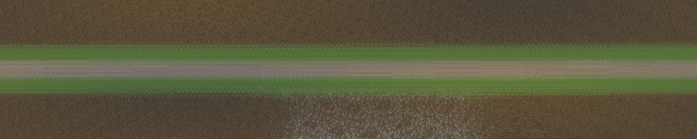

# Standard Track JSON (STJ) Specification v0.3 (draft)

## 1. Overview and scope

STJ describes a race track or rally stage so that any simulator or physics engine can load it through converters: where the road is, what it is made of, how it grips, how a race on it is timed and run, and what surrounds it. It is the sister format of [SVJ — Standard Vehicle JSON](https://github.com/RFloEng/SVJ-standard-vehicle-json). SVJ says what a car is; STJ says what it drives on.

Like SVJ, STJ is **a vocabulary, not an engine**. A converter to a given simulator picks what that simulator understands, maps the rest onto its nearest equivalent, and says what it dropped.

**Use cases.** Running one game's physics on another game's tracks (for example RBR NGP physics via ReRBR on stages built for other games); keeping tracks of abandoned or second-tier games usable; authoring once (in Blender or from survey data) and shipping to several engines.

**In scope (v0.1):** metadata and provenance, the reference line, glTF geometry, surfaces and their physics, timing, race data (grid, pits, racing lines, pacenotes), environment (location, sun, sky, lighting, default weather), and scenery (vegetation and objects as prototypes, instances and scatter layers).

**Added in v0.2:**
- runtime state signals with declarative conditions
- terrain heightfields and water bodies
- how surfaces get wet and dry
- rubber and swept-line states
- seasons and surface substitution
- physical props, animated objects, audio, and UI and minimap data
- layered ground shading: detail layers, weights, height blend, macro maps

**Added in v0.3:**
- race control: marshal sectors, posts, vehicles, restricted zones, reset rules
- evolution during an event, with reference laws
- large worlds: chunks with local origins and tiles
- reflection probes, screens, crowds and climate statistics
- OpenUSD: USD meshes next to glTF, the STJ document inside a USD layer, `.usdz` single-file tracks

**Non-goals.**

- STJ is not a mesh format. Geometry is glTF 2.0, road layout is OpenDRIVE, high-resolution road profiles are OpenCRG. STJ references them; it does not re-specify them.
- STJ is not a renderer description. Visual materials are whatever glTF carries. Shaders, post-processing and engine lighting rigs stay engine-specific (`x_<engine>`).
- STJ is not a game-logic format: no missions, scripts or scoring rules beyond timing and track limits.
- **STJ is not an extraction tool.** Nothing in STJ is designed around getting assets out of games. Converters read files the user owns; they do not decrypt, unpack protected archives or bypass any protection. A file converted from a commercial game is marked `licence.redistributable: false` and stays with the user (§5.2).

---

## 2. Design principles

Inherited from SVJ (SVJ_Spec §1):

1. **Explicit over implicit.** Values are stated. Where STJ defines a default, the schema says so.
2. **Everything optional.** Only `_metadata` is required. A centerline and one surface is a valid, drivable file.
3. **Multi-fidelity.** Use what you have: a polyline or OpenDRIVE; surface bands or a collision mesh; effective loose-surface parameters or terramechanics.
4. **Extensible.** Engine-specific data lives in `x_<engine>` keys at any level (`x_ac`, `x_rbr`, `x_beamng`, `x_rf2`, `x_acr`, `x_ue`). Parsers MUST ignore unknown `x_` keys. Keys starting with `_` (`_note`, `_source`, `_est`) are annotations; `_est: true` marks an estimate.
5. **Human-readable.** JSON, SI units, meaningful names, no binary blobs. Binary data lives in the referenced standard files.
6. **Validatable.** `schema/stj.schema.json` (JSON Schema Draft-07) for structure; `tools/validate.py` for everything a schema cannot express (§12).

**New in STJ:**

7. **Semantic first, native alongside.** A tree is a tree with a species and a height, a sky is a sky model with a turbidity. The original engine's own representation travels next to it in `x_<engine>`, so a converter back to that engine (or a sibling) reuses the engine's optimised systems instead of a generic mesh (§8).
8. **Honest about portability.** Where a value cannot mean the same thing in two engines, the spec says so (§14) instead of pretending.

**Deliberate deviation from SVJ:** the STJ schema sets `additionalProperties: false` on its objects, allowing only `x_` and `_` keys besides the defined ones. SVJ accepts unknown keys and its validator warns afterwards (SVJ v0.99.4 found converters writing `inboard_point` for `inboard_mount`, silently ignored). STJ rejects typos at schema level. A runtime parser still SHOULD ignore keys it does not know, so newer files degrade gracefully.

---

## 3. Files

### 3.1 Single file

One `<name>.stj.json` with every section inline, plus the files it references (glTF, OpenDRIVE, OpenCRG, images) by **relative** URI. Absolute paths and URLs are not permitted (as SVJ §22.2).

### 3.2 Modular files (`$ref`)

Any object may be `{"$ref": "relative/path.json"}`; the parser replaces it with that file's content. Resolution is relative to the file containing the `$ref`, nesting is allowed, circular references are an error. Identical to SVJ §3.2. Typical use: `scenery` or `race.pacenotes` in their own files.

### 3.3 Override files

`<name>.stj-override.json` names a `base` and a `patch` applied with **RFC 7396 JSON Merge Patch**, exactly like SVJ §3.4: objects merge recursively, `null` deletes a key, arrays are replaced wholesale. The base may itself be an override; the chain is resolved base first. The merged result MUST validate against `stj.schema.json`. Relative URIs in the result are resolved against the **base** file's folder.

`_metadata.variant` says what the override is: `weather` (wet), `time_of_day` (night), `layout`, `season`, `setup`, `other`.

```json
{
  "_metadata": { "specification": "STJ-OVERRIDE", "version": "0.1", "base": "./coll_de_prova_gravel.stj.json", "variant": "weather" },
  "patch": { "environment": { "default_weather": { "condition": "rain", "water_depth": 0.0015 } } }
}
```

Because arrays are replaced wholesale, an override that changes one sector or one pacenote must repeat the whole array. This is a known cost of RFC 7396 and the reason most variant data (weather, time) sits in objects, not arrays.

### 3.4 Packaging and Blender

**Delivery package** (what engines and converters read) is one of two forms:
- **A folder**: the `.stj.json` plus its glTF or USD files, and optionally `.xodr`, `.crg`, mask images and HDRIs.
- **A single `.usdz`**: the STJ document inside the USD layer (§7.8).

**Authoring package**: a single `.blend` file can hold the entire track. This was checked in Blender 5.2 (see `docs/blender_mapping.md`): the STJ JSON and an OpenDRIVE file as text blocks, surfaces as material custom properties, timing and grid as empties, the reference line as a curve, masks and HDRIs as packed images, instances as linked duplicates, scatter as geometry nodes. An exporter writes the delivery package from it. Engines do not read `.blend`; nothing in STJ requires Blender. `_metadata.authoring_source {uri, tool, tool_version}` names the file a package was made from, so a tool that edits the track can open it.

### 3.5 Layouts

One set of models often carries several tracks: GP and National circuits, a stage run in reverse with its own pacenotes. The **top-level document is the default layout**, and `track_info.layout` names it. `layouts[]` lists the alternatives:

```json
"layouts": [{
  "id": "ss1_reverse", "name": "SS1 reverse", "direction": "reverse",
  "timing": { "start": { "s": 30 }, "finish": { "s": 2026.5 }, "stop": { "s": 2146.5 } },
  "race": { "pacenotes": { "notes": [ … ] } }
}]
```

Selecting a layout (`stj_core.layout_document`) works as follows:

1. **`reference`, `timing` and `race` are replaced wholesale**, never merged. Their `s` values belong to the layout's line, so a merge would mix positions from two lines.
2. A layout **without its own `reference`** uses the base reference line. With `direction: "reverse"` it drives that line backwards: `s' = L − s` (mod L on a closed line, which keeps its first point so `s' = 0` stays at `s = 0`), and `t' = −t`. An OpenDRIVE `route` is reversed road by road.
3. When the layout has its own line or reverses the base line, nothing `s`-based is inherited from the top level: no timing, no race data, no top-level edges.
4. **Surface bands, CRG placements and top-level edges always stay on the base line** for every layout, because they describe the ground, not the race. A layout adds its own `edges` on its own line. A layout on a different road (a cut-through) brings that road's surfaces in a collision mesh or in OpenDRIVE.
5. `include_meshes` and `exclude_meshes` select geometry. `type` overrides `track_info.type`, and `default_laps` gives the race distance.

Selecting a layout with `layout_document` returns an ordinary STJ document, so converters for single-layout engines need no layout logic.

### 3.6 Variants

A variant is an override file (§3.3) whose `base` is this file. `variants[]` lists them so a tool opening the base knows they exist:

```json
"variants": [{ "id": "night", "kind": "time_of_day", "override": "test_ring_gp_night.stj-override.json", "material_variant": "night" }]
```

- `kind` is one of `time_of_day`, `weather`, `season`, `event`, `other`. RBR's morning, noon, evening and overcast stage variants are four `time_of_day` / `weather` entries.
- `material_variant` names a glTF `KHR_materials_variants` variant for texture swaps (wet asphalt, snow cover).
- `usd_variants {set: variant}` selects USD variant sets with the variant (§7.8): the JSON patch changes the semantics, the USD variant changes what the stage shows. A variant may have an override, USD variants, or both.
- The validator checks that each listed file is an override of this very file, applies it, and validates the result. It reports only the findings the variant adds.

---

## 4. Units and frames

### 4.1 Units

SI, as SVJ §2: m, kg, N, s, Pa, rad, m/s; temperature in °C. Exceptions, stated where they occur: **latitude and longitude in degrees** (WGS 84); **water rates in mm/h** (`precipitation`, `drain_rate`, drain `capacity`; in m/s they would read 2.8·10⁻⁷ and nobody could check them); light units follow glTF `KHR_lights_punctual` (lux for the sun, candela for point and spot lights); colour temperature in K. Curves are `[[x, y], ...]` with x increasing.

### 4.2 Track coordinates (s, t, h) and the reference line

- **s**: distance along the reference line (m), **measured in the x/y plane** like OpenDRIVE `s` (elevation does not lengthen it), increasing in the race direction.
- **t**: lateral offset (m), **positive to the left** of the race direction (OpenDRIVE `t`, OpenCRG `v`).
- **h**: height above the surface.

The reference line is either `reference.opendrive` (a file plus an optional `route` of road ids, chained in race order) or `reference.centerline` (a polyline of `[x, y, z]`). When both are present OpenDRIVE is authoritative; the centerline is a convenience copy for tools without an OpenDRIVE evaluator. A **closed** centerline (`closed: true`) connects its last point back to the first; do not repeat the first point. On a closed line `s` lies in `[0, L)` and every ordering rule is applied in **lap distance** `(s − s_start_finish) mod L`.

Timing lines, sectors, splits, pit lane, track limits, pacenotes, surface bands and poses are placed by `s` (and `t`). That is what makes ordering checkable (§12) and keeps timing correct when meshes change.

### 4.3 World frame

`_metadata.coordinate_system: "OpenDRIVE"`: right-handed, **Z up**, `x`/`y` horizontal in metres, heading counter-clockwise from +X (OpenDRIVE `hdg`). When the file is geo-referenced, +X is grid east and +Y grid north. The value is the one SVJ already lists in its `coordinate_system` enum.

Why not SAE J670 (Z down), the frame of SVJ vehicles: every standard STJ references is Z-up (OpenDRIVE, OpenCRG, PROJ/GIS, Blender; glTF is Y-up but up is positive). With Z up, OpenDRIVE and OpenCRG data pass through unchanged and elevation reads as elevation. SVJ is a body frame and STJ a world frame; they meet in one fixed rotation (§4.6).

**Geodesy, plainly:**

- STJ x/y are **map-projected**, not a tangent plane: a tangent plane drops away from the ground by d²/2R, about 2 m at 5 km and 18 m at 15 km, which bends a long stage. `environment.geo_reference.proj` holds the PROJ string or EPSG code, as OpenDRIVE `<geoReference>`. Geographic coordinates (degrees) are not allowed as x/y.
- Projections distort lengths. UTM is off by roughly −0.4 to +1 m per km, 10–25 m over a 25 km stage. **Recommended:** a local Transverse Mercator centred on the track (`+proj=tmerc +lat_0=… +lon_0=… +k=1`), where the error is negligible.
- `z` is height above `geo_reference.altitude`, the height of the origin above `vertical_datum`.
- Most game tracks have no geo-reference. Their x/y are a flat, right-handed, Z-up frame, nothing more.
- `environment.north_heading` gives true north (rad, CCW from +X), because grid north differs from true north by the meridian convergence and because ungeoreferenced tracks need it for the sun.

### 4.4 Precision and origin

JSON stores doubles, but engines mostly use float32. The resolution of float32 is about 2 mm between 16 and 32 km from the origin, coarse enough to make wheel contact jitter. Put the origin near the track's centroid and keep geometry within about 10 km. A converter that re-origins records the shift in `environment.origin_offset` (`x_original = x + origin_offset`). The validator warns beyond 10 km.

### 4.5 glTF and Blender

glTF 2.0 fixes its own frame (Y up, +Z front, metres), so STJ needs no axis declaration for glTF assets:

```
(x, y, z)_STJ = (x, −z, y)_glTF        (x, y, z)_glTF = (x, z, −y)_STJ
```

This is a +90° rotation about X, exactly what Blender's glTF importer and exporter apply with "+Y up". **Blender scene coordinates are STJ coordinates.** This was checked by round-tripping a generated ribbon through Blender 5.2: a point at known (s, t) lands within 0.6 mm.

### 4.6 Placing an SVJ vehicle

A pose (grid slot, pit box, spawn) places the **SVJ origin**, the front-axle midpoint at ground level (SVJ §2.1), at ground point `p` with heading `ψ`:

```
p_world = p + Rz(ψ) · diag(1, −1, −1) · p_SVJ
```

`diag(1, −1, −1)` is the 180° rotation about X that turns SAE x-forward / y-right / z-down into x-forward / y-left / z-up. Pitch and roll come from dropping the vehicle onto the surface. A pose is either world (`position`, `heading`) or track (`s`, `t`, `heading_offset` relative to the reference line tangent). Engines that spawn by centre of gravity or bounding box take the offset from the SVJ file.

---

## 5. Top level and `_metadata`

### 5.1 Top level

```json
{
  "_metadata": {}, "track_info": {}, "reference": {}, "geometry": {}, "surfaces": {},
  "timing": {}, "race": {}, "environment": {}, "scenery": {},
  "edges": [], "cameras": {}, "layouts": [], "variants": [],
  "water": {}, "audio": {}, "animated_objects": [],
  "dynamic": {}, "marshals": {}, "screens": [],
  "x_<engine>": {}
}
```

Only `_metadata` is required. Since v0.3 no top-level key is reserved: `dynamic` is §6.10, `marshals` is §10.1 and `screens` is §8.8. `animated_objects` was reserved in v0.1 and is an array since v0.2 (§8.5); a v0.1 file that used the reserved object must drop it, the one change in v0.2 that is not additive.

`track_info`: `name`, `layout`, `type` (`circuit`, `oval`, `rallycross` are lapped; `point_to_point`, `hillclimb`, `drag` are not; also `test_area`, `other`), `country` (ISO 3166-1 alpha-2), `location`, `length` (informational), `fictional`.

Since v0.2, `track_info` also holds what menus and timing screens show:
- `short_name`, `abbreviation` (at most 4 characters), `description`, `tags[]`
- `media {preview, thumbnail, logo, outline}`: relative URIs; `outline` is an SVG of the track shape
- `map {uri, extent}`: a north-up image placed like every STJ raster (§7.4). Without it, engines draw the map from the reference line, which is the most portable map.
- `records[] {category, time (s), driver, vehicle, date, event, source}`: public lap records

`primary_surface` (`tarmac`, `gravel`, `snow`, `ice`, `dirt`, `mixed`, `other`) says what a stage mostly is, so tyres and setups can be chosen before anything is loaded.

Pit count and length are not repeated: they follow from `race.pit_boxes` and the reference line.

### 5.2 `_metadata`

| Key | Required | Description |
|---|---|---|
| `specification` | yes | `"STJ"` |
| `version` | yes | `"0.1"`, `"0.2"` or `"0.3"`. The validator warns when a file uses keys newer than the version it declares. |
| `coordinate_system` | yes | `"OpenDRIVE"` (§4.3) |
| `units` | yes | `"SI"` |
| `description`, `created`, `author` | no | as SVJ |
| `source_format` | no | Original format if converted (`"Assetto Corsa"`, `"RBR/BTB"`, `"Blender"`), null for native |
| `licence` | no | `spdx`, `holder`, `url`, `redistributable`, `notes` |
| `provenance` | no | `type` (`original`, `scanned`, `converted`, `mixed`, `unknown`), `detail`, `confidence`, `scan {method, date, accuracy, operator}`, `converted_from [{format, tool, tool_version, source, date, lost[]}]` |
| `authoring_source` | no | `{uri, tool, tool_version}`: the editable file the package was made from (§3.4). Not shipped is fine (NOTE). |

`provenance` plays the role of SVJ's `data_origin`, extended for tracks: a scan has a method and an accuracy, and a conversion has a chain. Its `lost` list records what each step dropped. **`licence.redistributable: false`** marks a file converted from content the user may use but not share. Tools SHOULD refuse to publish or upload such a file.

---

## 6. Surfaces

### 6.1 The problem

Every simulator computes grip as f(tyre, surface, state). SVJ already describes the tyre: Magic Formula coefficients plus scaling factors λ (`pacejka.scaling`: `LMUX`, `LMUY`, `LKX`, …, all 1 when absent; SVJ §11.13.1). A surface "μ = 0.6" means nothing until both sides agree what μ = 1 is. Tyre data comes from abrasive belts on test rigs, from a game's fit to its own road, or from estimates, and SVJ did not record which.

### 6.2 STJ-REF and the tyre's reference surface

**STJ-REF** is dry, clean, unworn dense asphalt. All its factors are 1 by definition, and every STJ surface value is relative to it.

A tyre states the surface its coefficients describe. This is an additive SVJ field, proposed for SVJ v0.105 (`proposals/svj_tyre_reference_surface_proposal.md`):

```json
"tires": { "sets": { "gravel_r5": {
  "tyre_class": "gravel",
  "reference": { "load": 4000, "surface": { "stj_class": "gravel", "mf_scaling": { "LMUX": 0.76, "LMUY": 0.72 } } },
  "pacejka": { … }
} } }
```

When `reference.surface` is absent the tyre is taken to describe STJ-REF. Tyre classes: `slick`, `road`, `intermediate`, `wet`, `gravel`, `snow`, `studded`, `mud`, `offroad`.

### 6.3 Surface object and where surfaces apply

`surfaces.library` maps ids (`[a-z0-9_]+`) to surface objects:

| Field | Unit | Meaning |
|---|---|---|
| `class` | enum | `asphalt`, `concrete`, `kerb`, `painted_line`, `cobblestone`, `artificial_grass`, `grass`, `dirt`, `gravel`, `sand`, `mud`, `snow`, `ice`, `rock`, `water`, `metal`, `wood`, `wall`, `other`. Required. In practice the most portable field. |
| `mf_scaling` | – | `LMUX`, `LMUY` (λμx, λμy), `LKX`, `LKY`, `LCX`, `LCY`, `LEX`, `LEY`, `LXAL`, `LYKA`, `LTR`; names as SVJ `pacejka.scaling` |
| `by_tyre_class` | – | Per tyre class replacement of `mf_scaling`, `rolling_resistance`, `wet_response`, `deformable` (§6.5) |
| `rolling_resistance` | – | Added coefficient: `F = f · Fz` against the direction of travel. STJ-REF = 0. |
| `roughness` | – | §6.7 |
| `wet_response` | m → factor | Factor on `LMUX`, `LMUY` versus water-film depth |
| `deformable` | – | §6.6 |
| `track_limits` | enum | `inside` / `outside` (AC `IS_VALID_TRACK`) |
| `pit_lane`, `out_of_bounds` | bool | AC `IS_PITLANE`; touching resets the vehicle |
| `water` | – | `storage_depth` (m), `drain_rate` (mm/h), `wet_look` (§6.9) |
| `impact` | – | When the car body hits it: `friction`, `restitution`, `response` (`rigid`, `soft`, `bendable`). Rocks, snow walls, bushes. |
| `effects` | – | `dust {color, amount}`, `spray` 0–1, `marks {color, persistence: none \| drive \| event}`: what a driver sees from the surface; engines map these to their own particles |

**Where a surface applies**, highest precedence first:

0. **Surface maps** (`surfaces.maps[]`). The surface varies **inside** collision primitives, as on real ground, where gravel patches, swept wheel tracks and verges do not follow triangle edges.
   - A map names a collision mesh's material, a `palette` of surface ids, and weights in one of the `ground` encodings (§8.7): `vertex_top3` with `_STJ_SURF_LAYERS` / `_STJ_SURF_WEIGHTS`, `vertex_dense`, `image` or `id_map`.
   - `contact: blend` (the default) makes the contact's parameters (scaling factors, rolling resistance, deformable values, μ) the weighted mean of the palette entries present. `contact: dominant` takes the largest weight.
   - A map may carry `when` (a condition, §11.1). **The first map whose condition holds is used**; a map without `when` always holds. Bindings and ground materials take `when` the same way.
   - A single file can therefore hold one surface map per state, for example new / normal / worn × dry / damp / wet, chosen by the `wear` and `wetness` signals at load or live.

1. **Collision mesh materials.** For a glTF mesh with role `collision`, each primitive's material maps to a surface: either the material is named `STJ::surface::<id>`, or a `surfaces.bindings[]` entry `{mesh_ref, material | node, surface}` names it. The second form leaves imported meshes unrenamed. Every engine's mechanism reduces to this: AC mesh-name prefixes (`1ROAD`), RBR per-triangle material ids, BeamNG material `groundType`, ACR physical materials.
2. **OpenDRIVE lane materials**: `surfaces.opendrive_materials` maps `<material surface="…">` names to ids.
3. **Bands**: `surfaces.bands[]` `{s_start, s_end, t_min, t_max, surface}` along the reference line. Later bands win where they overlap. On a closed line `s_end < s_start` crosses s = 0. Bands make a centerline-only file drivable; `tools/ribbon_usd.py` turns them into a collision mesh.
4. `surfaces.default`.

**Terrain contacts** (§7.4) take the surface of the dominant terrain layer at the contact point. Terrain is a separate collision source: under a wheel, the higher of terrain and collision mesh is touched.

**Substitutions** (v0.2): `surfaces.substitutions {"from": "to"}` replaces the surface found above, whichever level found it. It is one step: a target must not itself be substituted. Because it is an object, an override merges into it: a winter variant is a substitution map plus the new surfaces, not a copy of every binding (§11).

### 6.4 SVJ tyre + STJ surface → grip

The normative recipe for one contact:

1. Find the surface at the contact point (§6.3), after substitutions.
2. If the surface has `by_tyre_class[<tyre_class>]`, use its values in place of the generic ones.
3. For every scaling factor *i* the surface gives:
   `λ_eff,i = λ_tyre,i · λ_surface,i / λ_tyre_ref,i`
   where `λ_tyre,i` is the tyre's `pacejka.scaling` (1 if absent) and `λ_tyre_ref,i` the tyre's reference surface (1 for STJ-REF).
3a. **Line states** (§6.8): multiply `LMUX` and `LMUY` by `1 + gain · r(s, t)`, with `grip_gain` on a dry contact and `wet_gain` where the film depth is above 0. In marbles, multiply them by the marbles factor. On a swept line, multiply `loose_layer_depth` as §6.8 says.
4. Multiply `LMUX` and `LMUY` by `wet_response(d)`, where `d` is the **effective film depth** at the contact (§6.9). The global depth comes from the weather (`environment.default_weather.water_depth` or the engine's live `water_depth` signal).
5. Evaluate the tyre (SVJ §11.13) with `λ_eff`. Add `−(rolling_resistance + drag_coefficient · v) · Fz` against the direction of travel, on top of the tyre's own rolling resistance.
6. Tyre models other than MF (TMeasy, brush, lookup tables) apply only the friction factors, to peak and sliding μ.
7. An engine with a soil model uses `deformable.terramechanics` for that contact instead of steps 3–5. Other engines use Tier A (§6.6).

A gravel tyre fitted on gravel (`λ_tyre_ref` = the gravel values) put on that gravel gets exactly the scaling it was fitted with. On asphalt it gets more grip, scaled by the ratio of the two surfaces.

### 6.5 Why `by_tyre_class` exists

**Absolute friction** (`surfaces.reference_mu`). Games and measurements give μ per tyre class × surface, not a scaling relative to a reference road.
- `reference_mu {<tyre_class>: {peak, sliding}}` states each class's μ on STJ-REF.
- A surface may then give `by_tyre_class.<class>.mu {peak, sliding}`, and `LMUX = LMUY = mu.peak / reference_mu.peak` for that class. It replaces those two factors of the entry.
- The one estimate per tyre class is declared once and visibly, instead of being hidden in every surface.

Step 3 assumes grip separates into a tyre factor times a surface factor. **It does not.** Compounds respond differently to microtexture (adhesion) and macrotexture (hysteresis), and on loose ground the tread pattern matters more than any scale factor: a slick and a gravel tyre on gravel are not related by a λ. `by_tyre_class` is where a surface says so, the way RBR and rF2 organise grip internally as tyre-type × surface tables. Use it whenever the generic factors would be wrong for a whole class of tyre.

### 6.6 Deformable surfaces

Two tiers, in the spirit of SVJ's multi-fidelity tyres.

**Tier A, `effective`.** Every engine can consume it; it is physically lossy. Together with `mf_scaling` and `rolling_resistance` it holds:

- `drag_coefficient` (s/m): `F = c · v · Fz`, ploughing.
- `base_offset` (m): depth of the hard ground below the surface mesh; a wheel cannot sink deeper.
- `sinkage` (m) at the tyre's reference load.
- `loose_layer_depth` (m) over a firm base.
- `base_surface`: what the tyre reaches through the layer, e.g. gravel on hardpack.

On loose ground `LKX`, `LKY` < 1 move the force peak to larger slip.

**Tier B, `terramechanics`.** Physically portable: Bekker–Wong pressure–sinkage `p = (k_c/b + k_φ) zⁿ` and Janosi–Hanamoto shear `τ = (c + σ tan φ)(1 − e^(−j/K))`, with `n`, `k_c` (N/m^(n+1)), `k_phi` (N/m^(n+2)), `cohesion` (Pa), `friction_angle` (rad), `shear_deformation_modulus` K (m), `bulk_density` (kg/m³). Published values exist for standard soils and snow; soil models of the Project Chrono SCM kind consume them.

What this does **not** achieve is stated in §14: loose-surface feel is not portable between game engines.

### 6.7 Roughness and water

- `roughness.iso8608`: ISO 8608 displacement PSD `Gd(n) = gd_n0 · (n/0.1)^(−w)` (m³, n in cycles/m), with optional class A–H.
- `roughness.crg_ref`: a measured OpenCRG profile (`geometry.crg`).
- `roughness.mean_profile_depth`: macrotexture MPD, ISO 13473-1 (m). Governs wet grip and drainage, not bumps.
- `roughness.sinusoid {amplitude, wavelength}` (m): a deterministic undulation `z = amplitude · (sin(2πx/λ) + sin(2πy/λ)) / 2`. Several games use exactly this instead of a spectrum; it is not an ISO 8608 profile.
- **Water depth** is weather state (`environment.default_weather.water_depth`, m). A wet override patches one number instead of every surface. **How grip responds** is a property of the surface (`wet_response`). Where the water stands, drains and is sheltered is track data (§6.9).
- **Hydroplaning** depends on tread depth, inflation pressure and speed, which are tyre properties SVJ does not record yet (open question Q3).

### 6.8 Line states: rubber and swept gravel (v0.2)

A racing line changes the surface under it: rubber builds up on tarmac, and loose stones are swept off gravel. `surfaces.line_states[]` describes that state **statically**, at the start of a session. How it evolves during the session belongs to the reserved `dynamic`.

| Key | Meaning |
|---|---|
| `id`, `kind` | `rubber` (paved) or `swept` (loose surfaces; RBR's new / normal / worn gravel) |
| `applies_to` | Surface ids the state lies on |
| `line`, `spread` | The racing line it follows (`race.racing_lines` id) and its Gaussian σ across the line (m) |
| `profile` | Optional `[[s, factor], …]`: braking zones carry more |
| `grip_gain {LMUX, LMUY}`, `wet_gain` | Grip gain on a dry contact; the gain that replaces it on a wet one (usually negative: a rubbered line is slippery in the rain) |
| `loose_layer_factor` | `swept`: factor on `deformable.effective.loose_layer_depth` at full state |
| `marbles {offset, LMU}` | Beyond `spread + offset` from the line, `LMUX` and `LMUY` are multiplied by `1 − (1 − LMU) · level` |
| `levels` | State level 0…1 per session (`practice`, `qualifying`, `warmup`, `race`, `stage`, `any`) |

The state at (s, t) is

`r(s, t) = level · profile(s) · exp(−½ ((t − t_line(s)) / spread)²)`

where `t_line` is the racing line's lateral offset, found by projecting it onto the reference line. On a swept line, `loose_layer_depth` is multiplied by `1 − (1 − loose_layer_factor) · r`. A variant changes the state by patching `levels`. AC `groove.ini` and rF2 RRBIN presets can be **fitted** to this form; the original files stay in `x_ac` and `x_rf2`.

### 6.9 Wetting and drying (v0.2)

Rain is weather; how it collects is the track. Every engine that simulates a wet track (rF2 RealRoad, AMS2 LiveTrack, ACC, iRacing, CSP RainFX) reads track properties that do not change during a race. STJ stores those properties; the simulation of how water builds up and dries stays with the engine and the reserved `dynamic`.

**Per surface**, `water`:
- `storage_depth` (m): water the macrotexture holds before a film forms. The default is half of `roughness.mean_profile_depth`. Porous asphalt sets it high.
- `drain_rate` (mm/h): run-off and soak-away with no rain. A surface stays dry while `precipitation` < `drain_rate`.
- `wet_look`: `puddles`, `soaks`, `rough` or `none`. These map 1:1 to CSP's `PUDDLES_MATERIALS`, `SOAKING_MATERIALS` and `ROUGH_MATERIALS`. Visual only.

**Per track**, in `water` (§7.5):
- `accumulation`: a greyscale PNG covering `extent` (factor `2 · v / v_max`). `accumulation_bands[] {s_start, s_end, t_min, t_max, factor}` mark the same along the reference line; later bands win over earlier ones and over the map. Both mark where water stands: dips, ruts, flat corners.
- `drains[] {id, kind, position | band, capacity}`: `kind` is `grate`, `channel`, `kerb_drain`, `soakaway` or `other`; `capacity` is in mm/h over the drain's catchment.
- `shelter[] {id, kind, band | polygon, factor}`: where rain does not reach. Tunnels, bridges and roofs have factor 1; tree canopy is partial.
- `dry_line {line, spread, factor}`: a snapshot of a drying line, for a "drying" variant.

**Effective film depth** at a contact (used in §6.4 step 4):

`d = max(0, water_depth · A · (1 − shelter) · D − storage_depth)`

- `A` is the accumulation factor (1 where nothing is given).
- `shelter` is the largest shelter factor at the point.
- `D = 1 − (1 − factor) · exp(−½ ((t − t_line) / spread)²)` is the dry-line factor.

`tools/stj_core.film_depth` is the reference implementation. `drain_rate`, `drains` and the `precipitation` signal are inputs for engines that **evolve** `water_depth` (§6.10). A static converter applies the formula with the variant's numbers.

### 6.10 Evolution during an event (v0.3)

Everything above describes **states**: a rubber level, a water depth, a worn surface map. `dynamic` describes how those states **evolve** while cars run and the weather changes.

STJ fixes simple, first-order **reference laws**. An engine may run its own, better model. But the numbers in a file are calibrated against these laws, so a "rubbering rate" means the same thing everywhere. Without a shared law it would be a number with no unit.

| Process | Reference law | `dynamic` keys |
|---|---|---|
| Rubbering, sweeping | per car pass: `level += gain · (1 − level)`; in rain: `d level/dt = −wash · precipitation · level / 3600` | `line_states[] {line_state, gain_per_pass, wash}` |
| Water film | `d depth/dt = precipitation · (1 − shelter) · A − drain_rate − evaporation` (mm/h), clamped ≥ 0, with `evaporation = e0 · (1 + c_wind · wind) · max(0, T_track − T_dew) / 10` | `water {e0, c_wind}`; `drain_rate`, `A` and `shelter` from §6.9 |
| Ruts on loose ground | per pass, in two wheel tracks `track_width` apart along a racing line: `depth += rate · (1 − depth / max_depth)` | `ruts[] {surfaces, line, depth_per_pass, max_depth, track_width, rut_width}` |
| Wear | the `wear` signal after N cars: `1 − exp(−N / cars_to_worn)` | `wear {cars_to_worn}` |
| Track temperature | first-order approach to `T_air + sun_gain · insolation · (1 − shade)`, time constant `tau` | `track_temperature {sun_gain, tau, shade}` |

- The starting states are the existing static blocks: `line_states[].levels`, the weather's `water_depth`, the surface maps chosen by `wear`.
- Marks and debris persistence is `effects.marks.persistence` on the surface.
- Reference implementations are in `tools/stj_core`: `line_state_after_passes`, `line_state_washed`, `water_step`, `evaporation_rate`, `dew_point`, `rut_depth_after_passes`, `wear_from_cars`, `track_temperature_step`.

---

## 7. Reference, geometry, edges, terrain and water

### 7.1 Reference

`reference` (§4.2): `opendrive {uri, version, route[{road, direction}]}`, `centerline {points, closed, width {left, right} | width_profile [[s, left, right]], chainage, tangents}`, `length` (needed only when the OpenDRIVE file is not shipped).

- **`chainage`**: a stored distance per point, starting at 0 and increasing. Where present it **defines s**.
  - Surveys carry chainage (kilometre posts), and a game's driveline carries its own stored distance. Neither equals the recomputed arc length exactly, and everything keyed to s would shift if STJ recomputed it.
  - The geometric length is checked against it (WARN beyond 1%).
  - On a closed line, the closing segment adds its geometric length.
- **`tangents`**: one cubic Hermite tangent `dP/du` per point (m, u = 0…1 over a segment). The line passes through the points and is smooth, instead of a polyline.
- **Within a segment, s maps linearly onto u.** With straight segments and no chainage this is exact arc length. Otherwise it is the stored-distance interpolation that drivelines use.

### 7.2 Geometry

`geometry.meshes[]`: `{id, uri, roles: ["visual" | "collision" | "lod"], lod {of, level, switch_distance}}`. `geometry.terrain` (v0.2) is §7.4. A mesh may be visual and collision at once. glTF node names that STJ tools generate or recognise follow SVJ's convention with an STJ prefix: `STJ::<category>::<id>`, with categories `collision`, `surface` (material names), `reference`, `timing`, `grid`, `pit`, `spawn`, `light`, `scatter`, `instance`, `helper`, `lod`.

`geometry.crg[]`: OpenCRG files placed on the reference line with the attributes of OpenDRIVE `<surface><CRG>`: `s_start`, `s_end`, `mode` (`attached`, `attached0`, `genuine`, `global`), `purpose` (`elevation`, `friction`), `t_offset`, `z_offset`, `z_scale`.

### 7.3 Edges

`edges[]` describes kerbs, verges and barriers by what they are, along the base reference line, so an engine can rebuild them with its own kerb, armco or tyre-wall assets instead of reusing a foreign mesh. The precedents are the Speed Dreams/TORCS side, border and barrier model, OpenDRIVE objects and GT6 Course Maker curbing.

| Key | Meaning |
|---|---|
| `side`, `s_start`, `s_end` | Where. `s_end < s_start` crosses s = 0 on a closed line. |
| `kind` | `kerb`, `verge`, `barrier` |
| `style` | kerb: `flat`, `raised`, `rumble`, `sausage`, `negative`. verge: `grass`, `gravel_trap`, `paved_runoff`. barrier: `wall`, `armco`, `tyre_wall`, `tecpro`, `fence`, `debris_fence`, `tape`, `hay_bale`, `concrete_block`, `rock`, `earth_bank`, `snow_bank`. All kinds: `other`. |
| `t` | Lateral offset of the inner side (m, positive left). Default: the road edge on that side. |
| `width`, `height` | m. Negative height for a drop: negative kerb, ditch. |
| `surface` | Surface id of the edge's top (kerb, run-off) |
| `restitution` | Barriers: coefficient of restitution of an impact, 0–1 |
| `kind: invisible`, `behaviour`, `drag_coefficient` | Invisible limits:<ul><li>`drag` slows a car that enters, with `F = c · penetration · Fz` against the velocity</li><li>`sensor` only signals</li><li>`respawn` resets the car</li></ul>Physical limits, not timing penalties. |
| `tearable` | Tape or net that tears on contact, stays torn for the drive, and gives no force back |
| `mesh {mesh_ref, node}` | Where the edge is already modelled |
| `prototype`, `spacing` | v0.2: the prop the barrier is built from (tyre stack, hay bale, block; §8.4) and the distance between elements (m) |

Edges add meaning to the geometry. They do not replace collision meshes: a converter that has the mesh keeps it, and uses the edge to pick native assets or physics (barrier restitution, kerb vibration).

### 7.4 Terrain (v0.2)

`geometry.terrain` is a heightfield, native to UE, Unity, BeamNG, Rigs of Rods and Speed Dreams. Converters to mesh-only engines (AC, rF2, RBR) triangulate it exactly and split it into primitives by dominant layer.

```json
"terrain": {
  "heightmap": { "uri": "terrain/height.png", "format": "png16", "size": [2049, 2049],
                 "extent": [-1024, -1024, 1024, 1024], "height_min": -12.0, "height_max": 188.0 },
  "holes": { "uri": "terrain/holes.png" },
  "layers": [
    { "id": "grass", "surface": "verge_grass", "tile": 4.0 },
    { "id": "dirt", "surface": "dirt_dry", "weight": { "uri": "terrain/splat.png", "channel": "r" },
      "material": { "mesh_ref": "terrain_mat", "material": "Dirt" }, "tile": 3.0 }
  ]
}
```

**Grid rules.** These are where converters go wrong:
- **Vertex-registered and axis-aligned.** Sample (i, j) is at `x = x_min + i·dx`, `y = y_max − j·dy`, with `dx = (x_max − x_min)/(nx − 1)`. **Image row 0 is the +Y (north) edge**, so the PNG reads like a map. Every STJ raster over an `extent` (weights, accumulation, scatter masks, the minimap) is placed the same way.
- **Formats.** `png16` is a 16-bit PNG whose first channel is the height: `height_min + v/65535 · (height_max − height_min)`, which gives 3 mm steps over 200 m. Greyscale is recommended; Blender writes RGBA. `raw_f32` is little-endian float32 metres, without a header. Both can be read without libraries. GeoTIFF and EXR are for converters.
- **Square cells** are expected (WARN otherwise). `2^n + 1` samples per side is what UE, Unity and RoR need (NOTE otherwise). STJ does not resample.
- **Blender.** Its image pixel buffer runs bottom row first. An exporter writing `pixels` directly must flip the rows.

**Layers.**
- The **first layer is the base**. Its weight is `1 − Σ(others)`, so it has no map.
- Other layers carry a weight map (8-bit PNG, `channel` `gray`, `r`, `g`, `b` or `a`), sampled bilinearly.
- A terrain contact takes the **dominant layer's** surface; blended friction is not portable.
- `material` names a glTF material that draws the layer, and `tile` gives its world repeat. `ground_layer` names a layered-ground layer instead (§8.7).
- Scatter attaches to the layer's surface through `area.surfaces`, like any other surface.

**Macro maps.** `macro[]` puts low-resolution maps over the whole heightfield. The keys are those of §8.7's `ground.materials[].macro`, without `texcoord` (a heightfield has no UVs): `{kind: tint | occlusion | other, uri, extent, encoding, strength}`. The image covers `extent` (default: the heightmap's), is sampled bilinearly, and its row 0 is the +Y (north) edge, like every STJ raster. `encoding` is `grey_centred` (default), `multiply` or `colour` (§8.7). The maps apply to the terrain's detail colour after the layer blend; road meshes keep the macro maps of their own `ground.materials[]`.

**Terrain and meshes.** The higher surface is touched. Authors keep terrain at least a few centimetres under road meshes, or cut `holes` (8-bit mask on the heightmap grid, non-zero = no terrain). The validator samples the terrain every 2 m along the reference line and warns where it rises more than 2 cm above it.

Tiles, streaming and terrain LOD are out of scope (open question Q14).

### 7.5 Water bodies (v0.2)

Top-level `water` holds `sea_level` (z of an infinite plane), `bodies[]`, and the wetting data of §6.9.

| Key | Meaning |
|---|---|
| `kind` | `sea`, `lake`, `pond`, `river`, `stream`, `ford`, `puddle`, `pool`, `other` |
| `outline` + `level` | Polygon bodies: `[[x, y], …]` and the water surface z |
| `path` | Path bodies (rivers, streams, fords): `[[x, y, z, width, depth], …]`; z is the water surface, flow runs along the path |
| `depth`, `density` | m, kg/m³ (default 1000). Omit `depth` where the bed is terrain or a mesh. |
| `flow_speed`, `flow_heading` | m/s; heading for polygon bodies |
| `bed_surface` | Surface of the bed |
| `wading_drag` | s/m, `F = c · v · Fz`, for engines without water physics |
| `drivable`, `out_of_bounds` | Fordable; or resets the vehicle (what engines without water physics do with a lake) |
| `fill` | Binding (§11.1), usually on `wetness`: a puddle's fraction of its full depth |
| `when` | Condition: the body exists only while true (puddles only when wet) |
| `mesh {mesh_ref, node}` | Visual water surface |

Inside a body, the film model does not apply. The bed surface applies with `wet_response` at its deepest tabulated value; engines with water physics add buoyancy and drag; others use `wading_drag`. Waves, foam and refraction stay in `x_<engine>`.

### 7.6 Large worlds (v0.3)

Stages of 20–50 km break the 10 km float32 rule (§4.4). STJ lets the world be cut into pieces, each with its own local origin, without splitting the file:

- **Chunks along s** (`geometry.chunks[] {id, s_start, s_end, origin, meshes[], terrain}`): a stretch of a stage.
  - Meshes that say `"chunk": "<id>"` are authored relative to the chunk's `origin`.
  - Everything else in STJ stays in world coordinates. JSON numbers are doubles, so that is exact.
  - Chunks may overlap in s, so an engine can load the next one before the current one ends.
- **A grid for open areas** (`geometry.tiles {size, origin, items[] {index [i, j], meshes[], terrain}}`): tile `[i, j]` covers `origin + [i·size, j·size]`, and its meshes are relative to that corner. A mesh refers to a tile as `"chunk": "tile_<i>_<j>"`.
- **Several terrains** (`geometry.terrains[]`, each with an `id`): one heightfield per chunk or tile. Their extents stay in world coordinates.

What is streamed, when, and at what budget stays the engine's. STJ says how the world is cut and where each piece's origin is. With chunks or tiles present, the validator downgrades the 10 km warning to a note. A chunk may name a USD `payload`: a file loaded on demand, its default prim placed at `origin`.

### 7.7 OpenUSD geometry

Meshes may be **OpenUSD** (`.usd`, `.usda`, `.usdc`, `.usdz`) as well as glTF (`proposals/stj_usd_proposal.md`).

- **glTF is the lean delivery form; USD is the rich one.** USD keeps what glTF drops: per-face data, curves, MaterialX, physics, audio, variants, payloads. Probe results are in `docs/blender_mapping.md` §4.
- **Frame.** The stage declares `upAxis = "Z"` and `metersPerUnit = 1`, which is the STJ world frame and Blender's default. Other values are allowed, but the validator warns and converters must apply them.

**USD equivalents of the glTF rules:**

| glTF | USD |
|---|---|
| Node or material `STJ::<category>::<id>` | `STJ__<category>__<id>`. USD forbids `::` in names; Blender already writes `__`. Both spellings mean the same in STJ. |
| `bindings[] {material \| node}` | `{material \| prim}`. `material` is a UsdShade material name, `prim` a prim path (Mesh or GeomSubset). Materials apply per face through GeomSubsets. |
| `_STJ_SURF_LAYERS` / `_STJ_LAYERS` (VEC3 per vertex, vertices split where the layer set changes) | **Uniform** (per-face) primvars, so no vertex is split. Either one `int3` primvar `stj_surf_layers`, or **three int primvars** `["stj_surf_layers_0", "_1", "_2"]`. Blender has no int3 attribute type, but it writes and reads three per-face integers (checked). |
| `_STJ_SURF_WEIGHTS` / `_STJ_WEIGHTS` (VEC2 per vertex) | `stj_surf_weights`: `float2`, `vertex` or **`faceVarying`** (per face corner), which avoids splitting vertices |
| Other `_STJ_*` attributes | `stj_<name>` primvars. STJ primvars use an **`stj_` prefix, not the `stj:` namespace**: Blender's exporter drops per-corner attributes whose names contain `:` (checked). |
| `TEXCOORD_n` | A UV primvar by name: `"texcoord": "st"` |
| A glTF animation by name | `time_range: [start, end]` in the stage's time codes. USD has no named clips. |
| `KHR_lights_punctual`, `EXT_mesh_gpu_instancing`, `extras` | UsdLux lights; PointInstancer or native instances; typed attributes in the `stj:` namespace on prims |

**The STJ JSON is normative.** Prims may also carry UsdPhysics (rigid body, mass, collider, physics material) or UsdMedia SpatialAudio for USD tools. Where they disagree with the JSON (for example `prototype.physics.mass` against the prim's MassAPI), the JSON wins and the validator warns.

### 7.8 STJ inside USD and single-file tracks

- **The document in the layer.** An STJ document may live in a USD root layer's `customLayerData["stj"]` as a JSON string. Tools read it from there and validate it like any `.stj.json`.
  - URIs are relative to the layer, and the document may name its own file as a mesh.
  - `tools/stj_usd.py embed` writes it into a layer and `extract` writes it back out.
- **`.usdz` = one file per track** (answers Q12). `tools/stj_usd.py package` writes the root layer first, then every file the document and the USD layers reference. Members are stored uncompressed and aligned to 64 bytes, as the format requires, and the validator also runs OpenUSD's own package rules.
- **Only USD layers, images (PNG, JPEG, EXR, AVIF) and audio (WAV, MP3, M4A) may go inside a `.usdz`.** So in a packaged track:
  - meshes are USD
  - terrain is PNG
  - override files are USD layers too (next point)
  - glTF, OpenDRIVE, OpenCRG and raw terrain need a folder package instead
- **Overrides as USD layers.** A variant's override can be a `.usda` layer that sublayers the track, sets the USD variant selections itself, and carries the STJ-OVERRIDE document in its own `customLayerData["stj"]`. Opened in any USD tool, it shows the variant. Opened by an STJ tool, it resolves like an `.stj-override.json`.
- **Validation of USD is optional.** USD checks need the `pxr` module (`pip install usd-core`). Without it, USD meshes are reported as a NOTE ("not checked"), and STJ documents inside USD cannot be read.

---

## 8. Scenery, sky, lighting and engine-native data

### 8.1 Why semantic plus native

Each engine has an optimised way to draw grass, trees, crowds and sky: GPU-instanced foliage, grass shaders bound to terrain materials, forest items, analytic skies. A converter that receives baked geometry (200 000 grass blades as triangles) cannot use any of them. So STJ describes scenery by **what it is**, with **where it grows** as a rule, and carries the source engine's own representation next to it:

- Converting **back to the same engine** (or a close relative): the `x_<engine>` block is used verbatim. Nothing is lost.
- Converting **to another engine**: the semantic fields (class, species, height, density, area) select the target engine's nearest native asset or system.
- Engines with neither: the optional generic `mesh` (glTF) is placed.

`x_<engine>` blocks reference assets **by name** in the user's installed game (`"forest_item": "pine_tall"`). They never embed the game's files, so a scenery description is not a copy of anyone's assets.

### 8.2 `scenery`

- `prototypes` (by id): `class` (`tree`, `bush`, `grass`, `groundcover`, `flowers`, `crop`, `rock`, `building`, `fence`, `barrier`, `tyre_wall`, `sign`, `pole`, `spectators`, `prop`, `other`), `species` (botanical name), `height`, `radius`, `collision` (`none`, `trunk`, `box`, `mesh`), `collision_radius`, `breakable`, `mesh {mesh_ref, node}`, `x_<engine>`.
- `instances[]`: `{prototype, transforms: [[x, y, z, heading, scale?], …]}`, upright in Z, or `{prototype, gltf {mesh_ref, node}}` for a node carrying `EXT_mesh_gpu_instancing`. Blender exports linked duplicates under one empty that way.
- `scatter[]`: `{id, prototypes [{prototype, weight}], density (per m²), area, exclude_surfaces, min_spacing, scale_range, align_to_normal, seed, cull_distance, x_<engine>}`. `area` is the intersection of the given keys:
  - `surfaces` (grow on these surfaces; how BeamNG groundcover, UE landscape grass and CSP grass attach)
  - `bands` (along the reference line)
  - `mask` (greyscale image + `extent`)
  - `mesh_attribute` (a per-vertex `_`-prefixed glTF attribute, which Blender exports from point attributes)

A scatter layer is a **rule**, not a list. Two engines given the same layer grow different individual plants; that is intended.

**Foliage sway.** A glTF attribute `_SWAY` (VEC3: amplitude m, frequency Hz, phase rad) per vertex describes how foliage moves, scaled by the `wind_speed` signal. Engines rebuild it with their own vertex animation.

Since v0.2, instance sets and scatter layers take `when` (a condition, §11.1), and scatter layers take `density_by` (a binding). That is how leafless trees appear in winter or grass disappears under snow, without the variant repeating the scatter array.

### 8.3 Sky and lighting

The sun, moon and stars follow from `geo_reference`, `north_heading`, `timezone` and the date and time. STJ does not store their positions.

- `environment.sky`: `model` (`physical` = single or multiple scattering atmosphere, `preetham`, `hosek_wilkie`, `hdri`, `engine_default`), `turbidity`, `hdri {uri, rotation, intensity}`, `clouds {coverage, kind}`, `fog {visibility, height_falloff, color}`. The Blender 5.2 Sky Texture types map directly.
- `environment.lighting`: `sun {illuminance, color_temperature}`, `lights[]` `{id, kind, type: point | spot, position, direction, intensity (cd), color_temperature, range, inner/outer_cone_angle, schedule: always | night | event}`, or `gltf_lights` naming a glTF mesh entry whose file carries `KHR_lights_punctual` (Blender exports its lights that way).
- Since v0.2, lights also take `when` (on while true) and `intensity_by` (a multiplier).
  - `schedule` stays as a shorthand: `night` means `sun_elevation < 0`, `always` means no condition, and `event` means the engine decides. `when` wins over `schedule`.
  - Floodlights that switch on below 3° of sun elevation live in the base file, so a night variant only moves the clock.
  - Start lights use `when: {signal: start_lights_lit, op: ge, value: n}`.

Engine lighting rigs, exposure and post-processing stay in `x_<engine>`.

### 8.4 Physical props (v0.2)

`scenery.prototypes.<id>.physics` makes a prototype a rigid body: cones, tyre stacks, hay bales, water barriers (rF2 loose objects, LFS, CSP).

| Key | Meaning |
|---|---|
| `mode` | `static`, `movable`, `breakable` (breaks or detaches above `break_impulse`, N·s), `tethered` (spring to its placed position: `tether {stiffness N/m, damping N·s/m, max_travel m}`) |
| `mass`, `center_of_mass` | kg; m in the prototype frame: X forward, Y left, Z up, origin at the base centre, like instance transforms |
| `inertia` | Principal moments about the centre of mass, prototype axes (kg·m²); must satisfy the triangle inequality |
| `shape` | `box {size}`, `cylinder {radius, height}`, `sphere {radius}`, `capsule {radius, height}`, `mesh` (convex hull of the prototype's mesh) |
| `friction`, `restitution` | Against the ground and in impacts. Surface factors do not apply to props. |
| `respawn` | `never`, `session`, `lap` |

`mode: bendable` (with `stiffness`, N·m/rad) makes saplings and posts bend under a car instead of stopping it.

Values are for scale 1. A scaled physical instance is a WARN, because engines disagree whether mass scales with the cube of scale. v0.1 `breakable: true` without `physics` means `mode: breakable` with engine defaults. Blender's Rigid Body settings map directly (mass, friction, restitution, shape), but the glTF exporter drops them, so the STJ exporter writes them.

### 8.5 Animated objects (v0.2)

`animated_objects[]`: flags, windmills, gates, barrier arms, scoreboards, crowds, helicopters.

| Key | Meaning |
|---|---|
| `id`, `kind` | `flag`, `windmill`, `gate`, `barrier_arm`, `crowd`, `vehicle`, `aircraft`, `scoreboard`, `machinery`, `other`; lets an engine substitute its own system |
| `target {mesh_ref, nodes[]}` | glTF nodes that move |
| `animation` | Name of a **glTF animation** in that file (TRS and morph weights; skinning allowed). Engine files (AC `.ksanim`, rF2 `.ANIM`) stay in `x_<engine>`. |
| `playback` | `loop`, `ping_pong`, `once`, `hold` |
| `speed_by` | Binding: playback-rate multiplier (windmill speed from `wind_speed`) |
| `time_by` | Binding: normalised animation time 0…1 instead of playback (a gate opened by `nearest_vehicle_distance`). Not together with `speed_by`. |
| `when` | Condition: plays while true; otherwise rests at time 0 (`hold`: last frame) |
| `collides` | The moving nodes are a kinematic collider |

Blender actions export as glTF animations under their action name (verified in Blender 5.2).

### 8.6 Audio (v0.2)

Top-level `audio`:
- `emitters[]`: `{id, kind, position | path, sound {uri}, gain, ref_distance, max_distance, rolloff, loop, cone {heading, pitch, inner_angle, outer_angle, outer_gain}, when, gain_by}`.
  - `path` makes a line source (grandstands, rivers).
  - Distance parameters follow the glTF audio-emitter drafts (KHR_audio_emitter); STJ does not depend on them.
  - `gain` is linear.
  - `kind` is `ambient`, `crowd`, `pa`, `music`, `birds`, `water`, `wind`, `machinery`, `generator` or `other`.
- `zones[]`: `{id, shape {band | polygon + z_min/z_max | sphere}, reverb, decay_time}`. Reverb presets are `open`, `forest`, `stands`, `urban`, `canyon`, `tunnel`, `underpass`, `garage` and `pit_building`.
- `ambience`: the preset outside every zone.
- `reflections [[s, left_m, right_m], …]`: the distance to reflecting surfaces on each side along the road. Engines use it for engine echo in cuttings and villages.

Sound files are WAV, Ogg Vorbis or FLAC, **made or licensed by the author**. FMOD and Wwise banks stay in `x_<engine>`, referenced by event name. Converters never extract a game's audio. Tyre and rolling sounds follow from the surface `class`; engine sound ids (AC `WAV`) stay in the surface's `x_<engine>`. Blender Speaker objects hold all emitter parameters and a packed sound, but the glTF exporter keeps only an empty node, so the STJ exporter writes `audio`.

### 8.7 Layered ground (v0.2)

Terrains are drawn the same way almost everywhere:
- a few small **detail layers** that repeat (colour, normal, height)
- **weights** that say where each layer goes
- a **height blend**, so stones show through grass before the grass fades
- large, low-resolution **macro** maps on top

glTF cannot express this, because a material has one base colour. Without `ground`, a converter can only bake the ground into images, which loses sharpness and the layers that BeamNG, UE, Unity and CSP rebuild natively. Rationale and the DR2 case: `proposals/stj_layered_ground_proposal.md`.

**`ground.layers`** (by id):

| Key | Meaning |
|---|---|
| `albedo {uri, height_in_alpha}` | Colour (sRGB). With `height_in_alpha`, the alpha channel is the layer's height. |
| `normal {uri}`, `height {uri, channel}` | Optional |
| `tile` | Metres per texture repeat (DR2 `WorldUVScale` 0.125 = 8 m) |
| `projection` | <ul><li>`world_xy`: top-down, u = x/tile, v = y/tile (the default)</li><li>`road`: along the reference line, u = t/tile, v = s/tile</li><li>`{texcoord, scale}`: a UV set of the primitive whose values times `scale` are metres, so u = uv·scale/tile. DR2's road UVs take scale 8.</li></ul> |
| `height_contrast` | How strongly the height pushes in the blend (DR2 `Thickness`), default 1 |
| `surface` | Physics surface; a contact takes the dominant layer's |

**`ground.materials[]`**: `{mesh_ref, material, palette[], weights, blend, macro[]}`. These name a glTF material, which keeps a plain base colour as the fallback for viewers that ignore STJ. `palette` lists layer ids, and weights refer to them by index.

**Weight encodings** (`weights.encoding`). Each source goes in losslessly, and converters translate between them: rasterise, keep the 3 strongest layers per triangle, or take the argmax.

| Encoding | Storage | Lossless for |
|---|---|---|
| `vertex_top3` | glTF `_STJ_LAYERS` (VEC3: the triangle's 3 palette indices, equal on its 3 vertices) and `_STJ_WEIGHTS` (VEC2: wa, wb; wc = 1 − wa − wb). Triangles with different layer sets do not share vertices. | DR2 |
| `vertex_dense` | `attributes`: VEC4 attributes, 4 palette entries each | vertex-painted meshes |
| `image` | `maps[] {uri, channels}` on a `texcoord` or over an `extent`; channels map to palette entries in order | Unity splatmaps, UE weightmaps, CSP masks |
| `id_map` | One map whose value is the palette index | BeamNG layer maps |

**Reference blend** (normative, so a Blender preview and an engine export agree). For the layers present at a point, with interpolated weights `w_i`, sampled heights `h_i` and each texture's mean height `mean_i`:

```
score_i = w_i + (h_i − mean_i) · height_influence · height_contrast_i
m_i     = max(score_i − (max_j score_j − depth), 0)
detail  = Σ colour_i · m_i / Σ m_i
```

- The defaults are `height_influence` 0.5 and `depth` 0.2.
- `method: linear` gives `detail = Σ colour_i · w_i`.
- Blend in linear colour.

**Macro maps** `macro[] {kind: tint | occlusion | other, uri, texcoord | extent, encoding, strength}`. `grey_centred` maps are linear data where 0.5 changes nothing: `final = detail · 2 · map`. `multiply` maps give `final = detail · map`. `colour` maps are sRGB images of the **average colour of the ground**, a baked colour map such as a game's heightfield terrain often has. The detail layers keep their texture and the map replaces their average colour. In linear light, with the layers' weights `w_i` and mean colours `mean_i`:

```
base  = Σ w_i · mean_i                          the layers' own average colour
ratio = clamp(map / max(base, ε), 0.25, 4)       per channel
final = detail · (1 + strength · (ratio − 1))
```

- `strength` runs from 0 (the detail is left alone) to 1 (the average colour of the result is the map's); the default is 1.
- Maps apply in order and the layers' average follows each one, so a later `colour` map re-targets the average instead of compounding with an earlier one: only the last `colour` map shows.
- Without ground layers, `base` is the base colour.
- Several `colour` maps apply one after the other; the validator warns about more than one.

**Terrain.** `geometry.terrain.layers[].ground_layer` names a ground layer instead of `material` + `tile` (§7.4), and `geometry.terrain.macro[]` carries the terrain's macro maps (§7.4).

**Tools.**
- `stj_core.ground_blend` and `apply_macro` are the reference implementations; `apply_macro` takes the layers' mean colour (`ground_mean_colour`) for the `colour` encoding.
- `tools/ground_bake.py` bakes a `vertex_top3` material, with its `grey_centred`, `multiply` or `colour` macro maps, into an image in any UV set. It is what a converter does for engines that cannot rebuild the blend (RBR, Speed Dreams).

DR2's own shader formula is not public; the reference blend was fitted to it by eye (§14).



### 8.8 Probes, screens and crowds (v0.3)

- **Reflection probes** (`environment.probes[] {id, kind: reflection | irradiance, position, extent, priority, when}`): where an engine should capture local reflections or lighting, such as tunnels, pit garages and dense forest. `extent` is the box around `position` where the probe applies.
- **Screens** (`screens[] {id, target {mesh_ref, node, material}, content, uri, when}`): scoreboards and big screens.
  - `content` is one of `timing_tower`, `leaderboard`, `replay`, `live_camera`, `image`, `video` or `other`. The engine fills the semantic contents.
  - `image` and `video` need a `uri`.
- **Crowds** (`scenery.crowds[] {id, area, density, prototype, behaviour, flee_distance, when}`): spectators as a rule instead of thousands of instances.
  - `area` is a band along the line or a polygon; `density` is people per m².
  - `behaviour` is `static`, `cheer`, `follow` (turn to watch the car) or `flee` (step back to `flee_distance` from a passing car).
  - With `when` and the `time_to_arrival` signal, a rally crowd reacts to the car that is coming.

---

## 9. Timing

| Key | Meaning |
|---|---|
| `start_finish` | Lapped tracks |
| `start`, `finish`, `stop` | Point-to-point: start line, flying finish, stop control |
| `sectors[]` | `{id, s_start, s_end}`, contiguous, from the start (or start/finish) to the finish (or once round the lap) |
| `split_points[]` | `{id, s}` or explicit points; rally splits |
| `pit_lane` | `entry_s`, `exit_s`, `speed_limit` (m/s), `session_speed_limits {practice, qualifying, race}`, `limit_start`, `limit_end`, `path`, `side` |
| `track_limits` | `max_wheels_outside`, `use_surface_flags`, `boundaries[] {side, s_start, s_end, t}` |
| `drs_zones[]` | `{id, detection_s, activation_s, deactivation_s, gap}`, in race order; may wrap through s = 0 |
| `controls[]` | Rally controls besides start, finish and stop: `{id, kind, s \| position, target_time}`. `kind`: `time_control`, `start_control`, `stop_control`, `regroup_in`, `regroup_out`, `service_in`, `service_out`, `refuel`, `parc_ferme`, `other`. Placed by `s` on the route, by `position` off it. |
| `side_roads[]` | Junctions competitors must not take or cut: `{s, side, heading_offset, blocked_by, cut_penalty}` |

A timing line is `{s, t_min?, t_max?}` (full road width by default) or `{points: [[x,y,z],[x,y,z]]}` for a gate that does not follow the reference line.

---

## 10. Race data

- `grid[]`: `{position, pose}`, positions 1..N, pole first along the track.
- `pit_boxes[]`: `{id, pose, garage_pose}`.
- `spawns[]`: other named poses (stage start, hotlap start).
- `racing_lines[]`: `{id, purpose, closed, points, speed[], width[]}`. Speeds are vehicle-specific; say which vehicle in `_source`.
  - `race`, `qualifying`, `wet`: ideal lines.
  - `pit`, `pit_entry`, `pit_exit`: pit-lane paths.
  - `alternate`, `overtake_left`, `overtake_right`, `block`: AI side paths, as rF2 AIW left, right and block paths.
  - `formation`, `safety_car`: paced laps.
- `ai`: data beyond the lines.
  - `corridor`: `[[s, t_min, t_max], …]`, where the AI may drive (rF2 AIW corridor).
  - `hints[]`: `{s_start, s_end, kind, side, value}`, with `kind` one of `danger`, `caution`, `no_overtake`, `overtake`, `brake`, `speed_limit`, `stay_left`, `stay_right` (AC/CSP AI hints). `brake` and `speed_limit` values are target speeds in m/s; `danger` and `caution` values are severities 0–1.
- `start_procedure`: `type` (`standing`, `rolling`, `staggered`, `time_trial`), `formation_lap`, `formation_speed`, `rolling_start_speed` (m/s), `start_interval` (s, staggered rally starts), `lights {count, mesh_ref, nodes[]}` (glTF nodes of the start lights in lighting order).
- `service_areas[]`: `{id, kind, polygon}`; `kind` is `service`, `remote_service`, `refuel`, `regroup`, `parc_ferme` or `paddock`.
- `sections[]`: `{id, s_start, s_end, reference_time (s), surface, ratings {curves, rough, obstacles, straights}}`. Ratings run from 1 (little) to 5 (a lot). They give the stage's character for reference times, AI times and menus.
- `pacenotes`: `{scale: "ascending_1_6", language, written_for, notes[]}`. Each note is `{s, kind, direction, severity, length, distance_to_next, modifiers[], call, call_adjust}`.
  - `kind`: `turn`, `hairpin`, `square`, `acute`, `straight`, `crest`, `jump`, `bump`, `dip`, `water`, `narrows`, `widens`, `junction`, `bridge`, `tunnel`, `surface_change`, `keep_in`, `keep_out`, `caution`, `finish`, `other`.
  - Severity uses the ascending 1–6 scale (1 slowest short of a hairpin, 6 fastest still called). Notes written on another scale are converted, and the original wording stays in `call`. Modifiers come from a fixed list, plus `x_…` strings.
  - `s` is where the feature begins, not where the co-driver speaks.
  - **Call timing belongs to the consumer**: a lookahead in seconds of travel. `call_adjust` (s) asks for a note earlier (+) or later (−) than that.
  - `distance_to_next` and link words (*into*, *and*) are **derived** from the next note's position. Stored values are hints; the validator warns when they disagree with the positions.

**Cameras** (top-level `cameras`): TV and replay cameras in `sets[]` (AC `cameras*.ini` sets, rF2 `.cam`). Each camera has:
- `id` and `kind`: `static` faces `look_at`; `tracking` turns to follow the car.
- `position`
- `fov`: `[min, max]` vertical field of view in rad; equal values mean no zoom.
- `near`, `far`
- activation, either an `active {s_start, s_end}` range (AC, Speed Dreams) or `spheres[] {position, radius}` (rF2).

Post-processing, shake and lens effects stay in `x_<engine>`.

### 10.1 Race control (v0.3)

`marshals`:
- **`sectors[] {id, s_start, s_end}`**: marshal sectors, contiguous along s, independent of timing sectors. The `sector_flag` signal (§11.1) refers to them; the validator warns when it is used and there are no sectors.
- **`posts[] {id, kind, sector, s, side, position, signals[], light_panel}`**:
  - `kind` is `flag_post`, `light_panel`, `radio_point` (rally safety), `medical`, `fire`, `spectator_point` or `other`.
  - `signals` lists what the post can show: flags, plus `slippery`, `safety_car`, `virtual_safety_car` and `code_60` panels.
- **`vehicles[] {id, kind, pose | base}`**: `safety_car`, `medical`, `recovery`, `fire`, `course_car`, `helicopter`, `other`. `base` is a post id.
- **`restricted_zones[] {id, shape {band | polygon}, rule, value, when}`**:
  - `rule` is `penalty` (value in s), `reset`, `speed_limit` (value in m/s) or `no_entry`.
  - This is the geometric half of open question Q10. Sporting regulations per corner stay out of STJ.
- **`reset {mode, t, min_spacing, points[] {s, t, heading_offset}}`**: where a car is put back after leaving the road.
  - `nearest_on_line` projects onto the line at `t`, keeping `min_spacing` from explicit points and corner apexes.
  - `points_only` uses only the listed points.
  - `engine` leaves the choice to the engine.

---

## 11. Environment

`geo_reference {proj, latitude, longitude, altitude, vertical_datum}`, `north_heading`, `origin_offset`, `timezone` (IANA), `default_time {date, local_time}`, `sky`, `lighting` (§8.3), `default_weather {condition, air_temperature, track_temperature, relative_humidity, wind_speed, wind_from_heading, water_depth, visibility}`, and `weather_schedule[] {session, time, weather}`: weather changes during a session, applied from `time` seconds after its start, as rFactor 2 `.wet` schedules. `session` is `any`, `practice`, `qualifying`, `warmup`, `race` or `stage`. Wind direction is where the wind comes **from**, in rad CCW from +X.

Since v0.2:
- `environment.season {name, snow_cover, snow_depth, leaf_fraction, ground}` is the static season state. `name` is `spring`, `summer`, `autumn` or `winter`; `ground` is `thawed`, `frozen` or `waterlogged`. It sets the defaults of the `snow_cover` and `leaf_fraction` signals.
- Weather adds `precipitation` (mm/h).
- `weather_options[] {variant | weather, weight}` lists the conditions a track allows and how likely each one is, for event generation.
- `climate {source, monthly[] {month, t_min, t_max, rain_days, rain_mm, wind_mean}}` (v0.3): statistics for generating plausible weather on any date.
- A season variant patches the season block, adds the new surfaces and maps the old ones to them with `surfaces.substitutions` (§6.3).

### 11.1 Signals, conditions and bindings (v0.2)

A **signal** is a named value the engine supplies at runtime. STJ fixes the name, unit and range; the engine maps its own state onto it. A signal the engine does not support takes its **default**, so a converter without a runtime bakes the default state and still produces a sensible track.

| Signal | Unit / values | Default when unsupported |
|---|---|---|
| `sun_elevation` | rad, −π/2…π/2 | from `default_time` and the location |
| `local_time` | s since local midnight | `default_time` |
| `day_of_year` | 1…366 | `default_time.date` |
| `precipitation` | mm/h | weather |
| `water_depth` | m, film on the racing surface | weather |
| `wetness` | 0…1, how wet things look | 0 |
| `wind_speed` | m/s | weather |
| `snow_cover`, `leaf_fraction` | 0…1 | `environment.season`, else 0 and 1 |
| `session` | `practice`, `qualifying`, `warmup`, `race`, `stage` | `race` |
| `session_phase` | `pre_session`, `formation`, `countdown`, `running`, `suspended`, `finished` | `running` |
| `session_time` | s since session start | 0 |
| `flag` | `none`, `green`, `yellow`, `double_yellow`, `red`, `blue`, `white`, `chequered`, `safety_car`, `virtual_safety_car`, `code_60` | `none` |
| `start_lights_lit` | 0…`start_procedure.lights.count` | 0 |
| local `nearest_vehicle_distance` | m from the consumer | +∞ |
| local `sector_flag` | as `flag`, for the marshal sector (`marshals.sectors`, §10.1) at the consumer | `none` |
| `wear` | 0…1: 0 new or clean, 0.5 normal, 1 worn | 0.5 |
| local `time_to_arrival` | s until the nearest car reaches the consumer's s along the reference line | +∞ |

Local signals are evaluated at the position of whatever uses them. Engine-specific signals are named `x_<engine>_<name>`; a converter that does not know one uses the consumer's default.

- **Condition**: `{signal, op, value}`, where `op` is `eq`, `ne`, `lt`, `le`, `gt`, `ge` or `in` (with a list). Conditions combine with `all`, `any` and `not`. Enum signals take `eq`, `ne` and `in` only. There is no arithmetic and no scripting: the CSP "conditions" model, reduced to what every converter can translate. A leaf on a signal that is absent is false.
- **Binding**: maps a signal to a number. `curve [[in, out], …]` (linear, clamped) for numeric signals, or `map {value: out}` for enum signals. `smoothing` (s) is a first-order lag, so outputs do not flicker at a threshold.

The consumers are:
- lights: `when`, `intensity_by`
- animated objects: `when`, `speed_by`, `time_by`
- instance sets and scatter: `when`, `density_by`
- audio emitters: `when`, `gain_by`
- puddles: `fill`

`tools/stj_core.eval_condition` and `eval_curve` are the reference implementations.

---

## 12. Validation

`python tools/validate.py file.stj.json [more files] [--strict]` runs:

1. `$ref` expansion and override resolution (§3.2, §3.3). An override is checked against `schema/stj-override.schema.json` first.
2. JSON Schema validation of the resulting document.
3. Cross-reference rules:
   - **Ids**: every surface id used (default, bindings, bands, OpenDRIVE map, `base_surface`, scatter areas) exists. Mesh, CRG and prototype references resolve. Ids are unique.
   - **glTF**: bound materials and nodes exist in the file. `STJ::surface::<id>` names refer to real surfaces. Unbound collision materials are reported.
   - **Reference line**: OpenDRIVE roads in `route` exist; the centerline, OpenDRIVE and stated lengths agree within 1%; the track type matches `closed`; extent is within 10 km (§4.4).
   - **Along the line**: every `s` lies on the line. Start < splits < finish ≤ stop. Sectors are contiguous from start (or start/finish) to finish (or a full lap). Pacenotes are ordered. The grid is ordered from pole backwards. All of this is in lap distance on closed tracks.
   - **Race control**: DRS detection, activation and deactivation in order; control and service-area ids unique; side roads on the line; a weather schedule never goes back in time within a session.
   - **Edges and cameras**: styles that fit the kind; `t` on the stated side; surfaces and meshes exist; `fov` min ≤ max and plausibly in radians; static cameras have `look_at`; `near` < `far`.
   - **AI**: corridor `s` increasing, `t_min` < `t_max`, no more than 2 m past the road edge; line `speed` and `width` arrays as long as `points`.
   - **Layouts**: timing, race data and edges of each layout are checked on that layout's own (or reversed) reference line; `include_meshes` and `exclude_meshes` exist.
   - **Variants**: each listed file is an override of this file; the applied result is validated, and findings it adds are reported under `variants[i](id)`.
   - **Units**: angles beyond 2π (degrees given?), speeds above 40 m/s in a pit lane, 60 m/s at a start or 120 m/s on a line (km/h given?), water deeper than 2 cm, macrotexture above 20 mm, temperatures outside −50…80 °C, projections in degrees.
   - **Signals** (v0.2): known names; enum signals use `eq`, `ne` or `in` with valid values; numeric values in range (degrees given for `sun_elevation`?); curves for numbers and maps for enums; `start_lights_lit` within the light count.
   - **Terrain**: files readable, `size` matching the image, square cells, `2^n + 1` sizes, layer surfaces and materials, hole mask on the same grid, terrain no higher than 2 cm above the reference line.
   - **Water and surfaces**: body shapes per kind, positive widths and depths, bed surfaces, drivable and out-of-bounds not both; accumulation, drain and shelter bands on the line; `dry_line` and line states naming real racing lines; substitutions to existing surfaces with no chains; rubber not on loose surfaces, swept lines on deformable ones.
   - **Props, animation, audio, UI**: inertia triangle inequality, tether for tethered props, unscaled physical instances; glTF nodes and animation names exist; `ref_distance` < `max_distance`, open audio formats; media and map files exist.
   - **Ground**:
     - palette ids exist
     - every attribute the encoding and projections need is on the primitives of the named material
     - `vertex_top3` indices lie inside the palette and agree over each triangle
     - weights are in range
     - image maps have enough channels
     - `tile` is plausibly metres, not repeats per metre
   - **Chainage and surface maps**: chainage starts at 0, increases, has one value per point and is within 1% of the geometry; tangents per point and of plausible length; surface-map palettes, attributes and indices; no map hidden behind an earlier unconditional one; absolute μ only with `reference_mu` for the class; invisible edges with a behaviour; sections and reflections in order; weather options naming real variants.
   - **Race control and evolution** (v0.3):
     - marshal sectors join and posts lie in their sector
     - vehicle bases exist; penalties and speed limits have values, and speed limits are in m/s
     - `sector_flag` is used only with sectors
     - evolution laws name real line states, lines and surfaces
     - ruts are on loose surfaces and within their maximum
   - **Large worlds and presentation**:
     - chunks join, their meshes say which chunk they belong to, and their terrains exist
     - tile indices are unique and array terrains have ids
     - screen targets exist
     - crowd prototypes exist and densities are plausible
     - climate months are unique and consistent
   - **OpenUSD** (with `pxr`):
     - stage axes and units
     - material, prim and primvar names exist
     - per-face layer indices lie inside the palette, and weights are in range
     - UV primvars are named
     - USD targets use `time_range`
     - `usd_variants` name real variant sets and variants
     - UsdPhysics agrees with the JSON
     - `.usdz` packages follow OpenUSD's package rules
   - **Version**: keys newer than the declared version.
   - **Notes**: an unused surface or prototype, a missing licence, `redistributable: false`, reserved keys.

ERROR fails a file; WARN fails it with `--strict`; NOTE never fails.

---

## 13. Relation to other standards

| Standard | Role in STJ |
|---|---|
| SVJ | Vehicles. STJ surfaces scale SVJ tyre factors (§6.4); poses place the SVJ origin (§4.6); same conventions for `x_`, `_est`, overrides, `$ref`, naming. |
| ASAM OpenDRIVE | Road layout and reference line (`reference.opendrive`), lane materials (§6.3), the world frame (§4.3), `s`/`t` and `<geoReference>`. STJ adds what OpenDRIVE does not carry: grip physics, race timing, racing data, scenery semantics. |
| ASAM OpenCRG | High-resolution road elevation or friction grids (`geometry.crg`), placed like OpenDRIVE `<CRG>`. |
| OpenUSD | Rich geometry and single-file tracks (§7.7, §7.8): primvars, GeomSubsets, UsdPhysics, UsdMedia, variant sets, payloads, `.usdz` packages. The STJ document may live in a layer's `customLayerData`. |
| glTF 2.0 | Lean delivery meshes. `KHR_lights_punctual` for lights, `EXT_mesh_gpu_instancing` for instances, custom `_` attributes for scatter density, `extras` for per-node and per-material STJ data, animations for `animated_objects`. Audio parameter names follow the KHR_audio_emitter drafts. |
| PNG | Heightmaps (16-bit), weight, hole and accumulation maps, minimaps (§7.4) |
| ISO 8608 / ISO 13473-1 | Road roughness PSD / macrotexture (§6.7). |
| RFC 7396 | Override files (§3.3). |
| PROJ / EPSG | Geo-reference (§4.3). |
| SPDX | Licence identifiers (§5.2). |

---

## 14. Where portability is a lie

STJ can carry these values, but cannot make them mean the same thing everywhere. Converters MUST NOT present them as more than they are.

1. **Loose-surface feel.** None of the consumer engines in scope (RBR/NGP, DiRT Rally 2.0, ACR, BeamNG, AC) publishes its loose-surface model, and each tunes its surface tables against its own tyres. A Tier A value taken from game X encodes game X's tyre model; under game Y's tyre it will not feel the same. Tier B is physically portable but unused by games, and Tier A cannot be derived from Tier B without a tyre model. The best a converter can do is fit Tier A for one reference tyre and mark it `_est` with a `_source`.
2. **Surface friction from games.** A game's surface friction number (AC `FRICTION`, a BeamNG groundmodel `staticFrictionCoefficient`) is relative to that game's own tyres and road. Turning it into λ relative to STJ-REF assumes the game's road ≈ STJ-REF, which is unverified.
3. **Grip separability.** `λ_tyre × λ_surface` is an approximation (§6.5); `by_tyre_class` patches it, it does not fix it.
4. **Roughness.** Games expose vibration knobs (AC `SIN_HEIGHT`, `SIN_LENGTH`, `VIBRATION_*`), not road profiles. ISO 8608 → one sinusoid discards the spectrum; the reverse is a guess.
5. **Racing lines and pacenotes** are vehicle-specific. An AI line with speeds for a GT3 car is wrong for a Fiat 500. A "4" for an R5 is a "5" for a Group B car.
6. **Scenery** is regenerated, not reproduced (§8.2); a converted forest is a similar forest. Sky models and lighting differ between engines in ways no parameter set fixes.
7. **AI data** says where and how carefully to drive. How well an AI follows it is the engine's AI, and the same hints give different racing in rF2 and AC.
8. **Edges** are semantics. An armco from STJ will be the target engine's armco, with that engine's crash physics. `restitution` is a hint, not a crash model.
9. **Geo-referenced game tracks.** Most game tracks have no geo-reference. Placing one on a map by eye gives the sun direction, not survey accuracy.
10. **Signals need a runtime.** STJ can say "floodlights on below 3°" or "the gate opens when a car is within 8 m". A target without scripting (RBR, AC without CSP) can only bake one state. Converters MUST report which bindings they baked.
11. **Terrain resolution and blending.** UE, Unity and RoR need `2^n + 1` grids, BeamNG needs powers of two, and mesh engines need triangles. Every resample moves the ground by millimetres to centimetres, which is enough to make a road mesh and the terrain fight. Layer blending is engine shading; physics sees one dominant layer.
12. **Water physics and drying.** Only BeamNG-class engines simulate buoyancy and wading. Elsewhere a ford is a surface with `wading_drag`, which is a made-up number. STJ says where water stands, drains and is sheltered, not how fast a track dries: the same `drain_rate` dries an rF2 track and an AMS2 track at different speeds, and RBR cannot dry at all.
13. **Rubber and swept lines.** No engine publishes its rubber or gravel-sweeping grip model. Gains are estimates, and fitting rF2 RRBIN data to the parametric form loses detail.
14. **Kinematic colliders.** A moving gate that collides is simple in BeamNG or UE and absent in many sim engines. There it becomes a static collider in its rest pose, or none.
15. **Audio** is re-mixed, not reproduced. Presets and distance curves give a similar soundscape; no two engines' reverbs sound the same.
16. **Ground blending.** DR2's real blend is not public, and UE, Unity and BeamNG each have their own height blend. The STJ reference blend is close to DR2's, not equal. In another engine the ground looks similar, not identical.
17. **Weight encodings.** Three layers per triangle → one layer id per texel (BeamNG) loses the soft transitions; the reverse invents them.
18. **Ground art.** Detail textures from a game are that game's art. A converted ground is `redistributable: false`. STJ stores the recipe and paths to the user's own files and never embeds them.
19. **Absolute μ.** `reference_mu` makes μ tables portable only as far as the one μ per tyre class on STJ-REF is right. For a game's tyres that number is an estimate.
20. **Surface blending.** Engines that take one surface per triangle receive surface maps as their dominant layer. Blended grip and sinkage across a transition is lost there.
21. **Evolution laws.** The reference laws are deliberately simple. An engine with a real rubber, water or rut model evolves the track differently. The laws make the numbers comparable, not the outcome identical.
22. **Crowd behaviour.** "Flee" or "cheer" is a request. How quickly and how plausibly spectators move is the engine's.
23. **Reset rules.** The same rule on two engines with different collision meshes can still put a car in a different place.
24. **USD support varies by tool.** USD can hold everything STJ needs, but each application's exporter writes a different subset. Blender 5.2 drops physics, audio, the sky, instancing and nested properties, and no racing game loads USD at runtime. The STJ JSON stays the part every consumer can rely on.
25. **Macro colour.** How an engine combines a baked colour map with its detail layers differs, and a given game's formula is usually not public. The `colour` encoding is a definition STJ can state exactly: in the original the ground will look similar, not identical.

---

## 15. Reserved, roadmap and versioning

**Reserved top-level keys:** none since v0.3.

**Roadmap.** The survey's three tiers are v0.1, v0.2 and v0.3. What remains open is in `docs/open_questions.md`: calibration procedures for friction, drying and rubber; the shared tyre-class list with SVJ; how the signal list grows; licences of converted content.

**Versioning**, as SVJ §20: minor versions are additive; patch versions clarify. A parser for an older version SHOULD ignore unknown keys of a newer one.

## 16. Changelog

| Version | Changes |
|---|---|
| 0.3 | Survey Tier 3 (`proposals/stj_tier3_proposal.md`). <ul><li>race control: marshal sectors, posts, vehicles, restricted zones, reset (§10.1)</li><li>`dynamic`: reference evolution laws for line states, water, ruts, wear and track temperature (§6.10)</li><li>large worlds: chunks with local origins, tiles, several terrains (§7.6)</li><li>reflection probes, screens, crowds (§8.8); climate statistics (§11)</li><li>no reserved keys left</li><li>OpenUSD (`proposals/stj_usd_proposal.md`): USD meshes with per-face layer primvars and per-corner weights (§7.7); the STJ document inside a USD layer, USD override layers, `usd_variants`, chunk payloads, `.usdz` packages (§7.8); `authoring_source`</li><li>macro maps on a heightfield terrain: `geometry.terrain.macro[]` and the `colour` encoding with `strength` (§7.4, §8.7; `proposals/stj_terrain_macro_proposal.md`)</li></ul> |
| 0.2 | Survey Tier 2, all additive except that `animated_objects` became an array. <ul><li>signals, conditions and bindings (§11.1)</li><li>terrain heightfields (§7.4)</li><li>water bodies, plus wetting and drying with an effective film depth (§6.9, §7.5)</li><li>line states: rubber and swept gravel (§6.8)</li><li>seasons and surface substitutions (§6.3, §11)</li><li>physical props (§8.4), animated objects (§8.5), audio (§8.6)</li><li>UI and minimap fields in `track_info` (§5.1)</li><li>light, instance and scatter conditions; edge prototypes; `snow_bank`; `precipitation` in mm/h</li><li>layered ground: detail layers, four weight encodings, reference height blend, macro maps (§8.7)</li><li>from RBR stages (`proposals/stj_lessons_from_rbr_proposal.md`):<ul><li>surface maps inside primitives with blending, and states chosen by `wear` / `wetness` (§6.3)</li><li>absolute μ with `reference_mu` (§6.5)</li><li>centerline chainage and Hermite tangents (§7.1)</li><li>sinusoidal roughness, `base_offset`, surface `impact` and `effects`</li><li>invisible drag edges, tearable fences, conditional water, bendable props, foliage sway</li><li>`time_to_arrival` signal, stage sections, weather options, acoustic reflections</li><li>pace-note `call_adjust`; `distance_to_next` treated as derived</li></ul></li></ul> |
| 0.1 | First draft. <ul><li>metadata, reference, geometry</li><li>surfaces: STJ-REF, MF scaling, per-tyre-class values, two-tier deformable model, bindings</li><li>timing: start/finish, sectors, splits, pit lane, track limits, DRS zones, rally controls, side roads</li><li>race: grid, pits, spawns, racing lines with AI purposes, AI corridor and hints, start procedure, service areas, pacenotes</li><li>edges (kerbs, verges, barriers), cameras</li><li>environment: geo-reference, sky, lighting, weather and weather schedule</li><li>scenery: prototypes, instances, scatter with engine-native blocks</li><li>layouts, variants, override files</li><li>validator</li></ul> |
